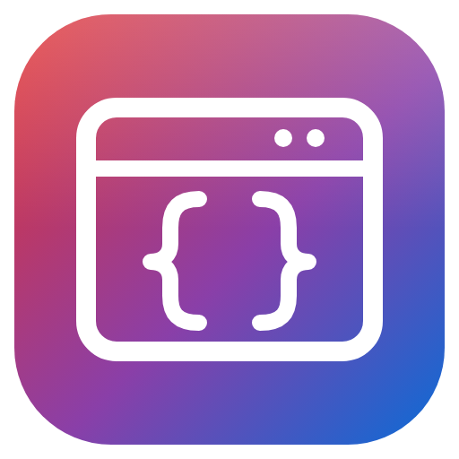
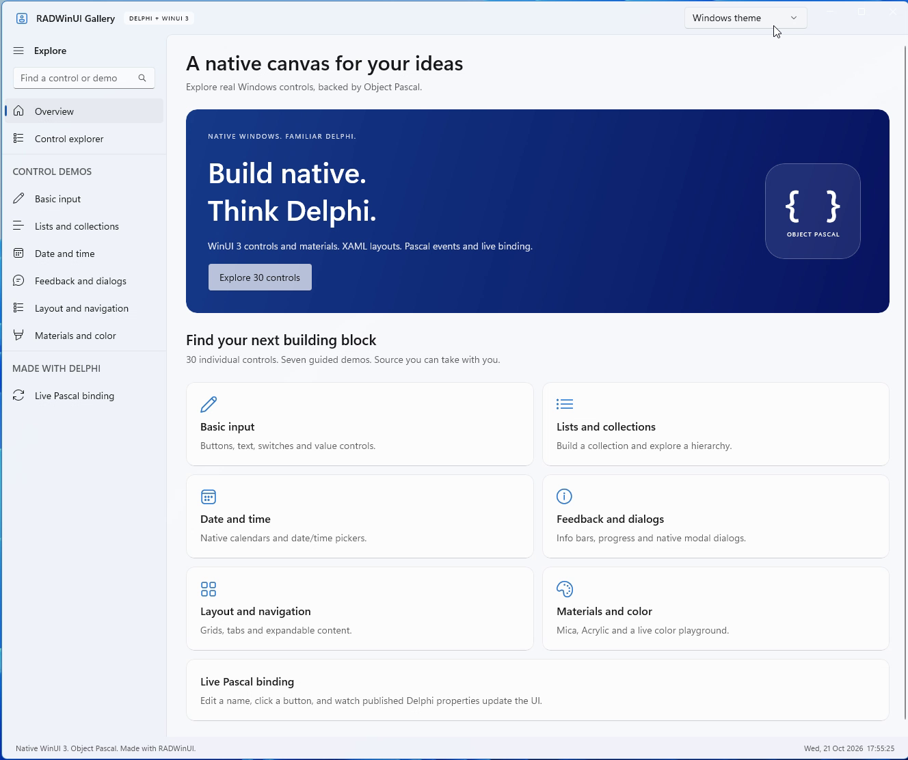
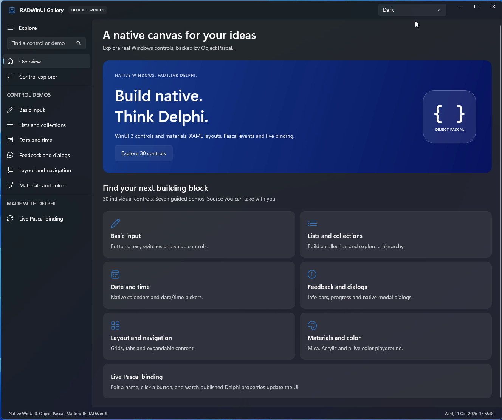
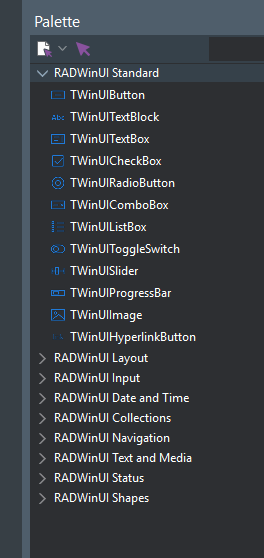
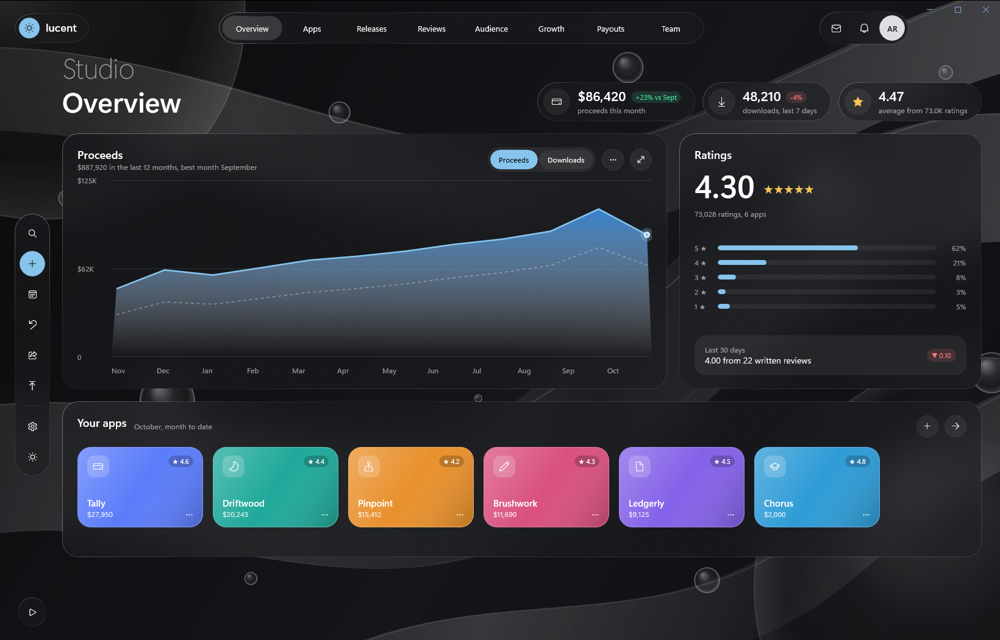
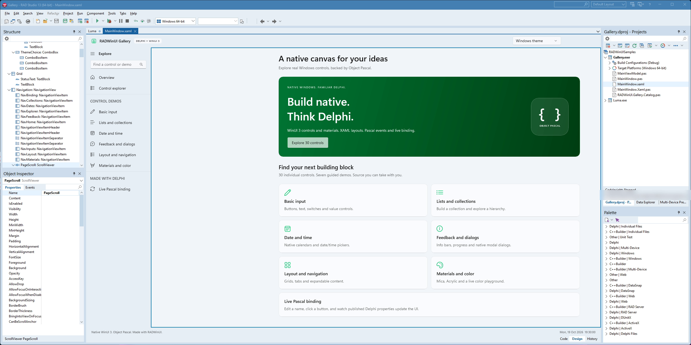
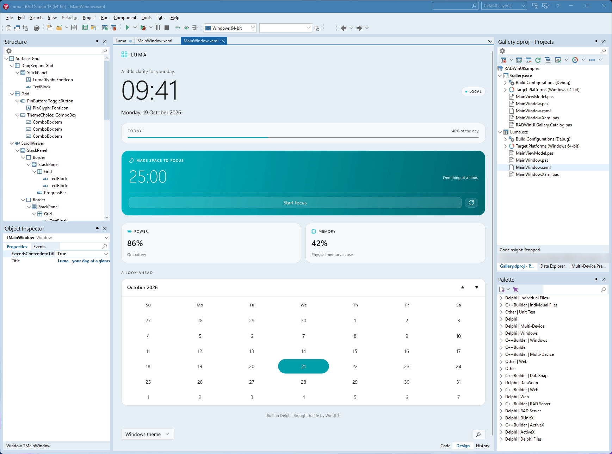
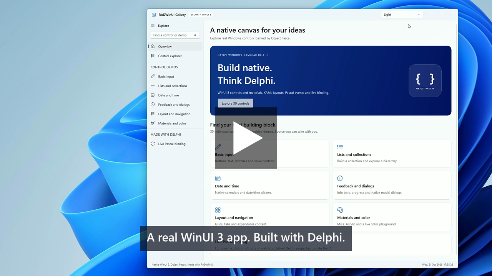

# RADWinUI

<p align="center">
  
</p>

<p align="center">
  Native WinUI 3 applications from Delphi, designed and built inside RAD Studio.
</p>

<p align="center">
  
  
  
  
</p>


## What It Is

RADWinUI lets you build real WinUI 3 applications with Delphi. You describe the window in XAML, write the logic in Object Pascal, and get a native Win64 executable. There is no .NET and no C#.

The controls are Microsoft's own WinUI 3 controls from the Windows App SDK: the same NavigationView, InfoBar, CalendarView, Mica and Acrylic that Windows 11 apps use. They are not VCL or FMX lookalikes.

RADWinUI works the way a Delphi developer expects. File > New creates the project, a Tool Palette and a visual designer sit in the IDE, the Object Inspector edits properties and events, and F9 runs the app.

## Main Features

- **Real WinUI 3 controls.** 1102 typed Pascal classes (`TWinUIButton`, `TWinUINavigationView`, ...) generated from Microsoft's metadata for Windows App SDK 2.5.1.
- **XAML plus Object Pascal.** Each window is a `.xaml` file and a `.pas` unit. A generated base class gives you one typed field per named control and wires events to your published methods.
- **Checked at build time.** Missing handlers, wrong handler signatures, unknown binding paths and unknown converters stop the build with the file, the line and a fix.
- **Data binding.** `{Binding}` to published properties of your Pascal classes, one-way and two-way, with built-in and custom converters.
- **File > New wizards.** RADWinUI Application and RADWinUI Window create ready-to-run projects.
- **Visual designer in the IDE.** A Design view next to Code (F12 switches), drag and drop from the Tool Palette, selection, move, copy, paste, delete, undo and redo. The XAML text stays the single source of truth.
- **Tool Palette.** 69 controls in nine categories (Standard, Layout, Input, Date and Time, Collections, Navigation, Text and Media, Status, Shapes), named like VCL (`TWinUIButton`) with their own icons.
- **Object Inspector and Structure view.** Edit WinUI properties and events in the native Object Inspector, see the control tree with icons in the Structure view.
- **Design-time sample data.** `d:` values and sample rows show in the designer, never in the running app.
- **XAML editor.** `.xaml` files open in Design first and get XML colouring in Code.
- **Live preview.** Tools > RADWinUI Preview renders the window in its own process while you type.
- **Modern Windows look.** Light, Dark and Windows themes, Mica and Acrylic backdrops, custom title bars, accent colours.
- **Deployment your way.** A small app (about 1 MB) for PCs with Microsoft's Windows App Runtime, or a self-contained folder with the runtime inside: nothing to install for the end user.
- **Crash reports.** A native crash writes a report and a minidump instead of closing the app silently.
- **Source only, no Python, no signing needed.** One project group per IDE builds everything RADWinUI needs on your machine.

## Screenshots

<table>
  <tr>
    <td align="center" width="50%"><br /><sub>Gallery app, light theme</sub></td>
    <td align="center" width="50%"><br /><sub>Gallery app, dark theme</sub></td>
  </tr>
</table>

<table>
  <tr>
    <td align="center" valign="top"><br /><sub>Luma, Acrylic</sub></td>
    <td align="center" valign="top"><br /><sub>Tool Palette, light</sub></td>
    <td align="center" valign="top"><br /><sub>Tool Palette, dark</sub></td>
    <td align="center" valign="top"><br /><sub>Structure view</sub></td>
  </tr>
</table>





## Supported IDE And Requirements

| Item | Version |
| --- | --- |
| RAD Studio / Delphi | 13 Florence |
| IDE | 64-bit IDE (`bin64\bds.exe`) and classic 32-bit IDE (`bin\bds.exe`) |
| Application platform | Win64 |
| Windows App SDK | 2.5.1 (stable) |
| Windows | 10 version 1809 or later, Windows 11 recommended |

The apps you build need the Windows App Runtime 2.5 (x64) on the end user's PC, unless you deploy them self-contained. WinUI 3 does not run elevated: do not start RAD Studio as administrator.

## Installation

RADWinUI ships as source code. RAD Studio builds everything on your machine, there are no prebuilt binaries to trust or sign.

0. **Get the source, then download the Windows App SDK files. Do not skip this in a clone.** Download a release ZIP and extract it to a new folder, or clone the repository. **In a clone, run this once in the RADWinUI folder before opening anything in RAD Studio:**

   ```text
   powershell -ExecutionPolicy Bypass -File scripts\Get-WindowsAppSDK.ps1
   ```

   Without these files the build stops with *Windows App SDK files are missing*. A release ZIP already contains them. Add `-InstallRuntime` if the Windows App Runtime 2.5 is not installed on your PC.
1. Start RAD Studio without administrator rights. If an older RADWinUI package is installed, remove it first (Component > Install Packages).
2. File > Open Project, in the RADWinUI folder, the group for your IDE:
   - `RADWinUI.groupproj` in the 64-bit IDE
   - `RADWinUI32.groupproj` in the classic 32-bit IDE
3. Right-click the project group > **Build All**. It builds the XAML code generator (`bin\XamlCodeGen.exe`), the preview and designer host, and the IDE package.
4. Right-click the package (`RADWinUIWizard.bpl` or `RADWinUIWizard32.bpl`) > **Install**.

The full guide is in [docs/GETTING-STARTED.md](docs/GETTING-STARTED.md).

## Quick Start

1. File > New > Other > Delphi Projects > **RADWinUI Application**. Give it a name and a folder.
2. `MainWindow.xaml` opens in the designer. Drop controls from the RADWinUI categories of the Tool Palette.
3. Select a control and set its properties and events in the Object Inspector. Double-click an event to write its handler.
4. Press **F9**.

```delphi
type
  TMainWindow = class(TMainWindowBase)   // TMainWindowBase is generated from MainWindow.xaml
  published
    procedure IncrementButtonClick(Sender: TObject);
  end;

procedure TMainWindow.IncrementButtonClick(Sender: TObject);
begin
  CounterText.Text := (StrToInt(CounterText.Text) + 1).ToString;
end;
```

```xml
<StackPanel Spacing="16" Padding="32">
    <TextBlock x:Name="CounterText" Text="0" FontSize="32"/>
    <Button x:Name="IncrementButton" Content="Increment"/>
</StackPanel>
```

## How To Use

**Design the window.** The `.xaml` editor has Code and Design views. Design shows the real WinUI rendering, hosted in its own process so the IDE stays stable. Drag controls from the Tool Palette, move them, and use Delete, Ctrl+C, Ctrl+V, Ctrl+Z and Ctrl+Y. Every change is a small, undoable edit of the XAML text.



**Edit properties and events.** The Object Inspector shows the WinUI properties of the selected control on the Properties tab and its events on the Events tab. Double-clicking an event adds the handler to your unit.

**Navigate with the Structure view.** It shows the control tree with the same icons as the Tool Palette. Selecting a node selects the control.

**Bind data.** Set `DataContextType="TMainViewModel"` on the window and bind with `{Binding Name}`. Properties of a `TWinUIBindableObject` notify the UI when they change. The build checks every binding path.



**Preview live.** Tools > RADWinUI Preview (or Docked Preview) renders the XAML you type, with design-time sample data.

More: [XAML reference](docs/XAML.md), [Framework API](docs/FRAMEWORK-API.md), [Object Inspector](docs/OBJECT-INSPECTOR.md).

## Samples

Open `samples\RADWinUISamples.groupproj`, Build All, and run:

- **[Gallery](docs/samples-Gallery.md):** 30 controls in seven guided demos, search, themes, Mica and Acrylic, XAML and Pascal source, and live Pascal binding.
- **[Luma](docs/samples-Luma.md):** an Acrylic desktop companion with a live clock, battery and memory readings, a focus timer and a calendar.
- **[Lucent](docs/samples-Lucent.md):** an app publishing studio in frosted glass over drifting ribbons: eight animated pages, live simulated data, a drag-and-drop release board, charts with a hover tooltip and a hero move to each app's page.
- **[Haven](docs/samples-Haven.md):** a bento-style savings dashboard that follows the Windows theme and accent colour, with a weekly chart, a countdown dial, a calendar and a goals checklist, all bound to a Delphi view model.

Smaller samples (Counter, Greeter, ListDemo, Contacts, Profile) show one topic each. They are in the same group, or build one with `scripts\Build.ps1 -Project samples\Counter\Counter.dpr`.

## Deployment

`scripts\Deploy-App.ps1` writes the folder you give to end users and checks that it runs outside the repository:

```text
.\scripts\Deploy-App.ps1 -Project samples\Counter\Counter.dpr                  # small app, about 1 MB
.\scripts\Deploy-App.ps1 -Project samples\Counter\Counter.dpr -SelfContained   # runtime included, about 55 MB
```

A small app needs Microsoft's free Windows App Runtime 2.5 installed once per PC, like the VC++ runtime or WebView2. A self-contained app needs nothing: copy the folder and run. See [docs/DEPLOYMENT.md](docs/DEPLOYMENT.md) for licensing, signing and setup notes.

## Notes And Limitations

- Applications are Win64 only. The IDE package works in both the 32-bit and the 64-bit IDE.
- RADWinUI targets RAD Studio 13 Florence and Windows App SDK 2.5.1.
- Apps ship as a plain folder: a small app, or a self-contained one.
- RADWinUI is not code-signed. Sign your own applications with your certificate.
- Push notifications and other Windows App SDK features that need the runtime's Singleton package do not work self-contained.

## Troubleshooting

| Symptom | Fix |
| --- | --- |
| `RADWinUI : error RW1001 : Windows App SDK files are missing`, or a post-build `copy` error in RADWinUIPreview | Run `powershell -ExecutionPolicy Bypass -File scripts\Get-WindowsAppSDK.ps1` once in the RADWinUI folder (step 0), then Build All again. |
| `RADWinUI : error RW1002 : RADWinUI was not found` | The project is outside the RADWinUI folder. Set `RADWINUI_ROOT` to the RADWinUI folder, then build again. |
| No Install on the package | Open the group of your IDE: `RADWinUI.groupproj` in the 64-bit IDE, `RADWinUI32.groupproj` in the classic 32-bit IDE. |
| `XamlCodeGen did not run`, or a build stops at its pre-build event | Open the group of your IDE and use Build All: it makes `bin\XamlCodeGen.exe`. |
| The app exits at start with a runtime error | Install the Windows App Runtime 2.5 (x64), or deploy self-contained. |
| Nothing happens when the app starts from the IDE | Start RAD Studio without administrator rights. |
| An app closed unexpectedly | Look in `%LOCALAPPDATA%\RADWinUI\Crashes` for its report. |

More in [docs/GETTING-STARTED.md](docs/GETTING-STARTED.md#troubleshooting).

## Demo Video

<!--
  GitHub video: drag the .mp4 into this README in GitHub's web editor (or into an issue) and
  paste the https://github.com/user-attachments/assets/... URL it gives you on its own line
  here. GitHub shows it as a video player.
-->
<p align="center">
  <a href="https://youtu.be/ryEtWZgUxhg">
    
  </a>
  <br />
  <sub>Watch the tour on YouTube: <a href="https://youtu.be/ryEtWZgUxhg">https://youtu.be/ryEtWZgUxhg</a></sub>
</p>

## Contributing

Issues and pull requests are welcome. Please read [CONTRIBUTING.md](docs/CONTRIBUTING.md). When you report a problem, include:

- your RAD Studio version and IDE (32-bit or 64-bit) and your Windows version;
- the steps to reproduce it, and the `.xaml` file if it is about a window;
- the RADWinUI log (`%TEMP%\RADWinUI\ide.log`) or the crash report from `%LOCALAPPDATA%\RADWinUI\Crashes`.

## Documents

- [Getting started](docs/GETTING-STARTED.md): from install to a deployed app
- [XAML reference](docs/XAML.md): what a window `.xaml` may contain and what the build checks
- [Framework API](docs/FRAMEWORK-API.md): the Pascal classes an app uses
- [Deployment](docs/DEPLOYMENT.md): shipping a small app or a self-contained one
- [Architecture](docs/ARCHITECTURE.md): the parts and how they fit together
- [Changelog](docs/CHANGELOG.md)

## License

RADWinUI is released under the MIT License. See [LICENSE](LICENSE). The Windows App SDK files that a release or an app redistributes are covered by Microsoft's terms: see [THIRD-PARTY-NOTICES.md](docs/THIRD-PARTY-NOTICES.md).

## Support

If RADWinUI helps you, please star the repository.

For direct support, email adehban@gmail.com.

---

<p align="center">
  
</p>

<h5 align="center">
Made with :heart: in Delphi
</h5>
