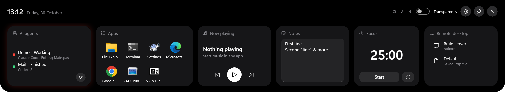
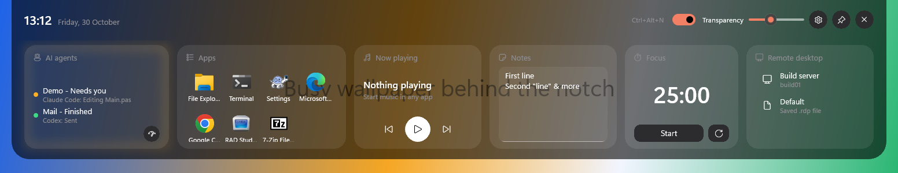
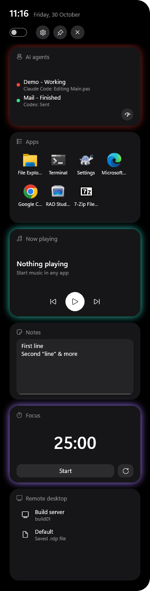
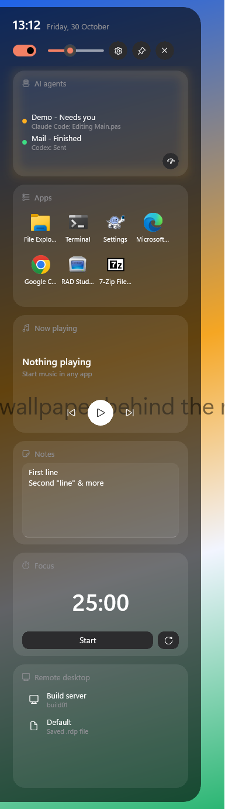
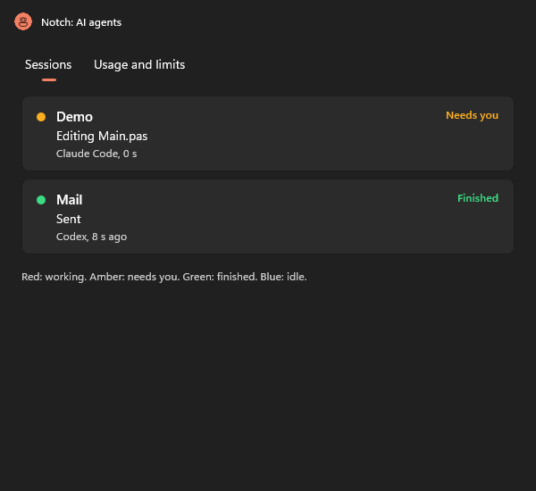
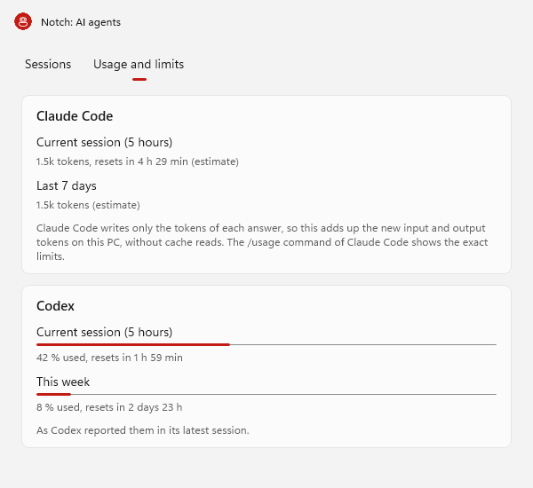
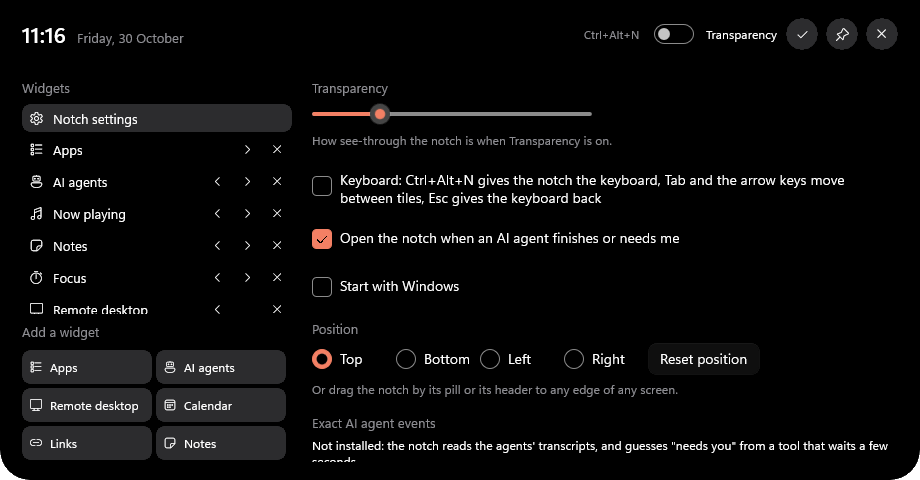

# Notch

A desk companion made with Delphi, WinUI 3 and RADWinUI. It hangs from an edge of the screen as a black pill with the time. Rest the pointer on it, or press Ctrl+Alt+N, and it opens into a panel of widgets. You pick the widgets, their order and what is in them, so the notch holds the tools you reach for all day.

By Ali Dehbansiahkarbon. MIT licence, like RADWinUI.





| Upright on a side edge | See-through | The agents window |
| --- | --- | --- |
|  |  |   |



## Widgets

| Widget | What it does |
| --- | --- |
| **AI agents** | What your AI coding agents are doing right now, live: Claude Code (in a terminal or the Claude desktop app) and Codex. Red and breathing while an agent works, amber and breathing when it needs you, green when it has finished, blue when it is idle. One session shows large with its project, what it does ("Editing MainWindow.pas") and for how long. Several show as rows. The tooltip lists them all, a click on the tile opens them in a window of their own, and the round button in its corner opens the usage limits. |
| **Apps** | A grid of shortcuts with their real icons. A click starts the app. Add as many Apps boxes as you like, for example "Work" and "Tools". |
| **Remote desktop** | Saved computers (name and address), opened with Remote Desktop. The `.rdp` files in Documents show up by themselves. |
| **Calendar** | Today in large type next to the month. A click opens the calendar of the taskbar, the same as a click on its clock. |
| **Links** | Web pages, files and folders, opened with their usual app. |
| **Notes** | A small text box, saved as you type. |
| **Now playing** | The music or video playing on the PC (Spotify, a browser, Media Player) with previous, play/pause and next. It glows while something plays. |
| **Focus** | A 25 minute timer that pulses purple while it runs and opens the panel when the time is up. |

The panel grows with the widgets, up to the width of the screen. Beyond that the row scrolls. Drag a tile by its header to give it another place, the other tiles make room where it will land. The Transparency switch lets the desktop show through the notch and its tiles, and the slider next to it sets how much. The tiles stay a little lighter than the panel, so they keep apart and their text stays readable. The pin keeps the panel open and the cross quits. Clicks next to the notch go to the windows below it.

The dot in the pill shows the most urgent agent state: amber when one needs you, then red while one works, then green when one has finished, otherwise blue. When an agent finishes or needs you, the notch opens for a few seconds (a setting turns this off).

## Edit mode

The gear in the header turns the panel into its edit page, inside the notch:

- **Notch settings** at the top of the list: transparency, keyboard, agent alerts, start with Windows, position and the exact agent events (see below).
- **Widgets** below it, in their order. Click one to edit it, move it left or right with the arrows, or remove it.
- **Add a widget** under the list. There can be one Now playing and one Focus widget, the other kinds as often as you like.
- On the right, the **name** of the selected widget and its entries, each with a button to remove it.
- An **Apps** widget has a search box over every app of the Start menu, Store apps included. A click on an app adds it. A path typed in the field above adds any program or file.
- An **AI agents** widget has a check box for each agent. The ones found on the PC can be ticked.
- **Remote desktop** and **Links** take a name and an address. An address without a scheme, such as `example.com`, becomes a `https://` link.

The check mark, or Esc, leaves edit mode. The page stays open while you edit, even when the pointer leaves it.

## Position

The notch hangs from the top, the bottom, the left or the right edge of a screen. On the top and bottom edges the panel is wide, the tiles side by side. On the left and right edges the pill stands upright and so does the whole panel: one tile wide, the tiles one under the other, the clock above the buttons, and on the edit page the list of widgets above the details. The panel grows with the tiles up to the height of the screen, then the column scrolls. It turns as soon as the notch reaches another edge. Pick the edge in the settings, or drag the notch by its pill or by the header of the panel: when you let go, it moves to the nearest edge of the screen it is on and keeps its place along that edge. "Reset position" puts it back at the top centre of the main screen.

## Keyboard

With "Keyboard" on in the settings, Ctrl+Alt+N opens the notch and gives it the keyboard, with the first tile focused. Tab and Shift+Tab go from tile to tile and through the buttons inside them, the arrow keys move in their direction, Enter and Space press the focused button. The panel stays open while it has the keyboard. Esc closes it and gives the keyboard back to the program you were in, and so does pressing Ctrl+Alt+N again. With the setting off, the notch never takes the keyboard from the program you use, except for the text boxes of the edit page and the note.

## AI agents

The notch reads the transcripts the agents write anyway, so it needs no setup:

- Claude Code writes each session to `%USERPROFILE%\.claude\projects\<project>\<session>.jsonl`, Codex to `%USERPROFILE%\.codex\sessions\<year>\<month>\<day>\rollout-*.jsonl`.
- Every second the notch reads the lines added to the sessions changed in the last ten minutes. A new file is read from its last 256 KB, after that only the new bytes.
- A prompt or a tool result means the agent works. A tool call shows what it does. The end of a turn means it finished. Sessions quiet for ten minutes drop out.
- "Needs you" is a guess in this mode: a tool call that has not gone on after 5 seconds is most likely waiting for your approval (20 seconds for shell commands, which may simply run that long). A question Codex asks counts at once.
- A finished session stays green until its next activity or for ten minutes, then it is idle (blue). After fifteen quiet minutes it drops out.

**Exact events** are an option in the settings. "Install hooks" adds hooks to Claude Code's `%USERPROFILE%\.claude\settings.json` (prompt, before and after each tool, notification, stop, end of session) and a `notify` command to Codex's `%USERPROFILE%\.codex\config.toml`. Both run `Notch.exe --agent-event claude|codex`, which stores the event in `%LOCALAPPDATA%\RADWinUI Notch\events` and quits at once, before WinUI starts. The running notch reads that folder. With the hooks, "needs you" comes from the agent itself. Each file is backed up as `*.notch-backup` first, other hooks stay as they are, and Codex is left alone when it runs another `notify` command already. "Remove hooks" takes them out again.

## Usage and limits

The round button of the AI agents tile opens the usage of each agent you watch, on the "Usage and limits" page of the agents window:

- **Codex** reports its limits in its own session files, so the notch shows them exactly: the current 5-hour window and the week, each with how much is used and when it starts again. The newest report of all recent sessions counts. A window that has started again since Codex reported it shows 0 %, with the time it reset.
- **Claude Code** writes only the tokens of each answer. The notch adds up the new input and output tokens (cache reads left out) of the current 5-hour block and of the last 7 days, and labels them "Tokens used on this PC (estimate), not your plan's limit".
- **Exact Claude limits** are an option, off by default: "Show exact Claude limits" in the settings, or the link on the Claude card. Then the notch asks your Claude account for the same figures Claude Code's `/usage` shows (the 5-hour window, the week, and the week per model), with the login Claude Code keeps on this PC. It reads that login for each request only, never stores, logs or renews it, and asks at most once a minute while the agents window is open. When the login has expired it says to open Claude Code, which renews it. When the account cannot be reached, the estimate stays, with a short note.

A thread reads the files the first time the window opens and then every minute, only what was added since.

## The agents window

A click on the AI agents tile opens a normal window with every session as a card: the coloured dot, the project, what it does, the agent and the time. It has Mica, its content goes up into the title bar, and it follows the light or dark look of Windows while it is open. The second page holds the usage limits.

## Settings

Everything is kept in `%LOCALAPPDATA%\RADWinUI Notch\settings.json`: the widgets in their order with their entries, the note, transparency and its level, the pin, the keyboard and alert options, the edge, the place along it and the screen. The file is written a moment after each change. App icons are cached as PNG files in the `icons` folder next to it. The `NOTCH_DATA` environment variable moves all of this to another folder.

"Start with Windows" adds the notch to `HKEY_CURRENT_USER\Software\Microsoft\Windows\CurrentVersion\Run` and takes it out again. The check box shows what the registry says, so it stays right when the entry is removed somewhere else.

The first run makes a useful start: an Apps box with up to six common apps found on the PC (File Explorer, Terminal, Settings, Edge, Chrome, RAD Studio and the like), the AI agents found on the PC, the calendar, Now playing and Focus. A file that cannot be read is kept as `settings.json.bad` and the notch starts again from these defaults.

## Build and run

Build `RADWinUI.groupproj` (or `RADWinUI32.groupproj` in the 32-bit IDE) once, it makes `bin\XamlCodeGen.exe`. Then open `community\Notch\Notch.dproj` (or `community\Community.groupproj`) in RAD Studio 13 and run Win64. Or, from the repository root:

```powershell
.\scripts\Build.ps1 -Project community\Notch\Notch.dpr -Config Release
.\community\Notch\Win64\Release\Notch.exe
```

Windows 11 with the Windows App SDK runtime (see [Getting started](../../docs/GETTING-STARTED.md)). Notch reads only local files, except the optional exact Claude limits, which ask the Claude account with your own login when you turn them on.

## How it is made

| Unit | What it holds |
| --- | --- |
| `MainWindow.pas` | The window: widgets in the panel, edit mode, settings page, dragging, keyboard, placement |
| `Notch.Settings.pas` | The settings and their JSON |
| `Notch.Widgets.pas` | The XAML of each widget, made at runtime, and what its buttons open |
| `Notch.Agents.pas` | The agent monitor: transcripts, hook events, states, and installing the hooks |
| `Notch.Shell.pas` | Installed apps (AppsFolder), their icons, opening apps, files and remote desktops, the taskbar calendar, start with Windows |
| `Notch.Usage.pas` | Usage limits: Codex's own figures, Claude Code's tokens added up, read by a thread |
| `Notch.Placement.pas` | Where the window goes on an edge, which edge a drop belongs to, where a dragged tile lands |
| `Notch.Details.pas` | The agents window: sessions and usage limits |
| `Notch.Tests.pas` | Checks of the parts without a window, run by the smoke test |

- **The window.** `<Window WindowStyle="Overlay" Backdrop="Transparent" ClickThrough="Background" ShowActivated="False">` makes a frameless, always-on-top window without a background, out of Alt+Tab and the taskbar, that opens without taking the focus. `MainWindow.pas` sets `HitTestElement := Notch`, so only the notch takes the pointer, and places the window itself against the edge from the settings (`Notch.Placement.pas`), so it has no `Dock`.
- **The notch.** `rw:NotchPanel` grows from the pill (`Pill`) into the panel (its content) with a springy animation and shrinks back when the pointer leaves. `AttachedEdge` says which screen edge it hangs from, `ExpandedWidth` and `ExpandedHeight` are set from code to fit the widgets or the edit page.
- **Moving it.** A press on the pill or the header starts the window's own move loop (`WM_SYSCOMMAND` with `SC_MOVE`, as a title bar would). When the loop ends (`WM_EXITSIZEMOVE`, seen in an override of `HandleMessage`), the notch snaps to the nearest edge.
- **Widgets from code.** Each widget is a piece of XAML made from its settings at runtime and loaded with `XamlReader`, inside an `rw:GlowTile` created from Pascal. Its buttons are wired with `Click.Add` and an anonymous method, like any event in code. A small `TFragment` class owns the wrappers of one piece, so a rebuilt widget frees the old ones.
- **Upright.** On a side edge the tile row becomes a column (`Orientation`), its scroll viewer scrolls down instead of sideways, the header's tools move under the clock and the edit page's details under the list (`Grid.SetRow` and `Grid.SetColumn` from code). The tiles are built again, all one width, each kind with its own height.
- **The taskbar calendar.** UI Automation finds the taskbar's clock button (class `SystemTray.OmniButton`) and presses it, which opens the same calendar as a click on the clock. Without it, Win+N opens the notification centre, which shows the calendar too.
- **Dragging tiles.** The header of a tile captures the pointer. While it moves, the tile follows through its `Translation` and the tiles in between move aside by one tile. On release the widget moves in the settings and the row is built again.
- **Edit page in the notch.** The window only takes clicks inside the notch, so a flyout or a dialog next to it would be cut off. The edit page is a second view of the panel instead.
- **Keyboard.** The window has `ShowActivated` False, so clicks never take the keyboard from the program in use. Where the notch needs the keyboard (the hotkey with the setting on, edit mode, the note), it turns `ShowActivated` on and calls `Activate`. The hotkey gives the process the right to come to the front. `XYFocusKeyboardNavigation` on the panel lets the arrow keys move between tiles.
- **Installed apps.** `Notch.Shell.pas` lists the shell's AppsFolder (`shell:AppsFolder`, enumerated with `IShellItem` and `IEnumShellItems`), which holds desktop and Store apps alike, and starts an app with `shell:AppsFolder\<its id>`. Icons come from `IShellItemImageFactory` and are saved as PNG with WIC, then shown by an `Image` that points at the file.
- **Transparency.** The window has no background of its own, so the switch changes the notch's `Background` between solid black and a black whose alpha follows the slider.
- **Ctrl+Alt+N** is an `rw:HotKey`, the music an `rw:MediaSession`. Both have no look, their events are wired by name like any other control's (`ToggleKeyPressed`, `MediaChanged`).

The Overlay controls come from the Overlay category of the Tool Palette, see [CUSTOM-CONTROLS.md](../../docs/CUSTOM-CONTROLS.md).

## Automated check

`Notch.exe -smoke-test <result file>` works in a temporary folder, never on your settings or the agents' files. It first runs the checks of `Notch.Tests.pas`: transcript lines of Claude Code and Codex and hook events turned into states, files read as they grow, installing and removing the hooks on copies that hold other hooks, and the placement maths. Then it checks the default widgets and the installed apps, opens the panel through the hotkey handler and checks its size, writes a Claude Code transcript and checks the AI agents tile turn from working to needs you, and runs `Notch.exe --agent-event` like a Codex hook. It uses the edit page (adds, moves and removes widgets, ticks agents, adds a remote computer and an app from the picker, opens the settings), drags a tile, saves and reloads the settings, refuses a broken file, and checks the focus timer, the media session, the pin, the transparency level and the keyboard mode. It turns the panel upright on the left edge (sizes, a tile dragged down, the edit page), moves it to the right, the bottom and back to the top with no sizes left over, and turns "Start with Windows" on and off on a test key of the registry. It finds the taskbar clock without clicking it, reads Codex limits and Claude Code tokens from test files, and opens the agents window on its usage page. It writes PASS or FAIL to the file and quits. Pictures of the panel, the settings page, the upright panel and pill, and the agents window in light and dark are saved next to the result file. Run it with `RADWINUI_TEST_MONITOR=offscreen` on a PC with one screen.

## Licence and notices

MIT, see the [LICENSE](../../LICENSE) of RADWinUI. Notch uses no third-party code or assets. App icons come from Windows at runtime, glyphs from the Segoe Fluent Icons font of Windows.
