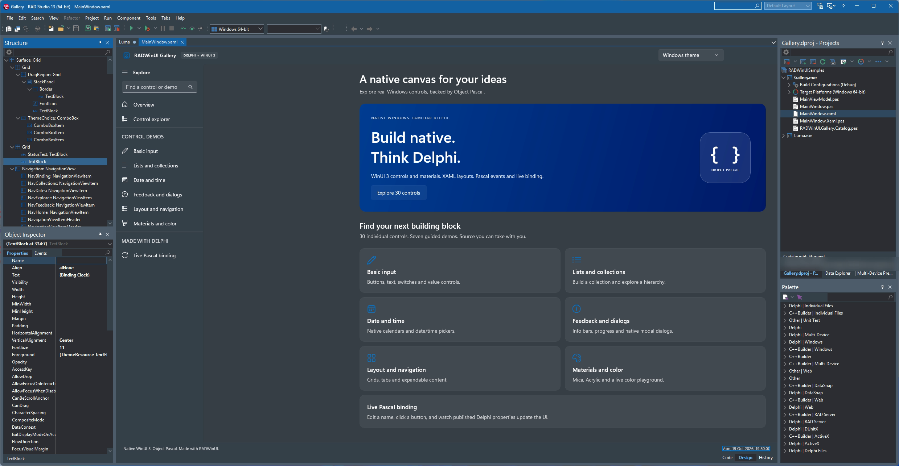

# Architecture

RADWinUI is a set of layers. The application only links the runtime layers, the IDE layers are design-time packages and never ship with an app.

```text
RAD Studio IDE          Wizard (OTA) · XAML Code/Design views · Tool Palette · Object Inspector · Structure  ──pipe──  WinUI design host (child process)
-------------------------------------------------------------------------------------
Framework               TWinUIApplication · TWinUIWindow · control wrappers · events · binding
Runtime                 Bootstrap · environment checks · dispatcher · XAML loading · metadata provider
Generated projection    Pascal units generated from Windows App SDK .winmd files
Interop core            combase: RoInitialize, HSTRING, activation factories, HRESULT errors
-------------------------------------------------------------------------------------
Windows App SDK 2.5.1   Microsoft.UI.Xaml (real WinUI 3 controls), DispatcherQueue, Composition
```



## Layers

**Interop core** (`src/Interop`). Hand-written declarations from `combase.dll` and the `EWinRTError` exception. Independent of the RTL's `Winapi.WinRT` so the projection controls its own types.

**Generated projection** (`src/Generated`, produced by `tools/WinMDGen`). Interfaces, runtime class helpers, enums, structs, delegates and events for `Microsoft.UI.Xaml.*`, `Microsoft.UI.*` and the `Windows.Foundation` types they use. Generic WinRT interfaces become concrete Pascal interfaces with precomputed IIDs. The units are committed so a clone builds without the generator, see [src/Generated](src-Generated.md).

**Runtime** (`src/Runtime`). Everything an app needs before the first control appears:
- `RADWinUI.Runtime.Environment`: elevation check
- `RADWinUI.Runtime.Bootstrap`: Windows App Runtime bootstrapper
- `RADWinUI.Runtime.Application`: `TWinUIApplication`, the Delphi subclass of `Microsoft.UI.Xaml.Application` (COM aggregation), with `IXamlMetadataProvider` forwarding and `XamlControlsResources` merged at launch

**Framework** (`src/Framework`). The developer-facing API: Pascal properties, events as method pointers with automatic token removal, WinRT errors as Delphi exceptions, `{Binding}` support through RTTI-based `INotifyPropertyChanged` and `ICustomPropertyProvider`.

**XAML code generation** (`tools/XamlCodeGen`, built into `bin\XamlCodeGen.exe`). Reads a `.xaml` file and emits a generated base class (`TMainWindowBase`) with one typed field per `x:Name` and the XAML embedded as a string constant, it checks handlers, binding paths and converters at build time ([XAML reference](XAML.md)). The user's class inherits from it, because Delphi has no partial classes. Handlers are wired by naming convention (`IncrementButtonClick`) or an attribute.

**IDE** (`src/IDE`). Design-time packages:
- `Wizard`: OTA project and window wizards, generated projects run XamlCodeGen before each build. The same units form two design-time packages, `RADWinUIWizard` (64-bit IDE) and `RADWinUIWizard32` (32-bit IDE)
- `Preview`: `RADWinUIPreview.exe`, a separate process that renders XAML with the real runtime. It renders the Design view inside the IDE and the Tools > RADWinUI Preview windows. The IDE sends editor text over a named pipe and receives designer events over a second pipe
- `Designer`: a ToolsAPI Code/Design view for `.xaml`, the RADWinUI Tool Palette categories, and adapters for the native Object Inspector and Structure view. The child host renders and reports design operations, the IDE applies them to the XAML editor buffer as single undoable edits (`RADWinUI.Designer.XamlEdit`). The palette lists 69 curated controls (`RADWinUI.Designer.Palette`). The ToolsAPI calls stay thin, all other design logic is IDE-free

## Shipping

An app is the exe plus `Microsoft.WindowsAppRuntime.Bootstrap.dll`, the end user installs the Windows App Runtime ([Deployment](DEPLOYMENT.md)). An app can also ship self-contained, with the Windows App Runtime in its folder. A RADWinUI release is source only: the repository layout plus Microsoft's signed bootstrap DLL, `RADWinUI.groupproj` builds the tools and packages on the user's machine (`scripts/Make-Release.ps1`, [Third-party notices](THIRD-PARTY-NOTICES.md)).

## Rules

- WinUI objects live on the thread that initialized XAML. Other threads go through the dispatcher.
- No WinUI code runs inside the RAD Studio process.
- XAML text is the source of truth, the designer edits text, never a hidden model.
- Code copied from other projects keeps its license notice. No code from the 2022 Embarcadero GetIt demo.
