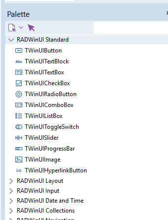

# Framework API

Implemented in `src/Framework` and `src/Generated/RADWinUI.Xaml.pas`, the samples use it and pass `scripts/Test-Samples.ps1` in Debug and Release.

The goal: apps with no raw COM code. App code uses Delphi strings, Delphi objects and Delphi events, `RADWinUI.Abi` stays available underneath but app code does not need it.

## Layers

| Unit | Kind | Content |
| --- | --- | --- |
| `RADWinUI.Abi` | generated | Raw ABI interfaces, `safecall` |
| `RADWinUI.Framework` | hand-written | `TWinUIObject` base, `TWinValue`, `TWinUIEvent<T>`, list classes, `Thickness()` |
| `RADWinUI.Xaml` | generated | One `TWinUI<Name>` wrapper per runtime class in `Microsoft.UI.*`, event handler types, `TWinUI` aliases of enums and structs |
| `RADWinUI.Forms` | hand-written | `TWinUIWindow`, `TWinUIApp`, `TWinUITimer` |

## Wrapper classes



WinMDGen emits a Delphi class per runtime class in `Microsoft.UI.*` (controls, event args, windowing, composition), named `TWinUI` plus the WinRT name: `TWinUIButton`, `TWinUITextBox`, `TWinUIStackPanel`, `TWinUIRoutedEventArgs`. The class tree mirrors the WinRT one, so `TWinUIButton` inherits `TWinUIButtonBase`, `TWinUIContentControl`, `TWinUIControl`, `TWinUIFrameworkElement`, `TWinUIUIElement` and `TWinUIDependencyObject`. Each class merges the properties, events and simple methods of every non-protected, non-overridable interface its runtime class implements. Nothing is hand-written per control.

Two wrappers are renamed to leave the plain names to the framework:

| Runtime class | Generated wrapper | Use instead |
| --- | --- | --- |
| `Microsoft.UI.Xaml.Window` | `TWinUICustomWindow` (like the VCL `TCustomForm`) | `TWinUIWindow`, which derives from it |
| `Microsoft.UI.Xaml.Application` | `TWinUICustomApplication` | `TWinUIApp` |

The generator stops with an error when any other generated name would clash with a framework type.

Type mapping:

| ABI | Wrapper |
| --- | --- |
| `HSTRING` | `string` |
| Runtime class (`IUIElement`) | Wrapper class (`TWinUIUIElement`), the most derived one the program links |
| `Object` (`Content`, `Header`, `Tag`) | `TWinValue` |
| `IVector<T>` of a runtime class (`Children`) | `TWinUIList<TWinUIUIElement>` |
| `IVector<Object>` (`Items`) | `TWinUIValueList` |
| Enum or struct | `TWinUI` alias (`TWinUIOrientation`, `TWinUIThickness`), the same type as in `RADWinUI.Abi` |
| Numbers, Boolean | unchanged |
| Interfaces that are not runtime classes (`ICommand`), delegates, generic instances | raw ABI type |

Every wrapper also exposes the raw object (`Button.WinRTObject`) and its default interface (`Button.Intf`) as an escape hatch.

Only the wrappers a program uses are linked: each registers itself in a class constructor. When an object's own wrapper is not linked (a `StackPanel` in a program that only mentions `TWinUIPanel`), `Wrap` asks the object for its interfaces (`GetIids`) and uses the deepest linked wrapper whose default interface it implements.

## Events

Each WinRT event gives two members:

```pascal
// VCL-style single handler, for the designer and published methods
TWinUIRoutedEventHandler = procedure(Sender: TObject; E: TWinUIRoutedEventArgs) of object;
Button.OnClick := ButtonClick;

// Any number of anonymous-method listeners; Add returns an id for Remove
Id := Button.Click.Add(
  procedure(Sender: TObject; E: TWinUIRoutedEventArgs)
  begin
    Greet('code button');
  end);
Button.Click.Remove(Id);
```

- `Sender` is the wrapper object, `E` is a wrapper of the event args (`TWinUIRoutedEventArgs`, `TWinUITextChangedEventArgs`, `TWinUIWindowEventArgs`, ...) with Delphi-typed properties.
- An event args wrapper lives for one call: it is freed when the handlers return, so a handler must not keep `E` or objects reached through it.
- Handler type names follow the args: `RoutedEventArgs` gives `TWinUIRoutedEventHandler`, `WindowEventArgs` gives `TWinUIWindowEventHandler`. Events whose args are `Object` pass a `TWinValue`.
- One WinRT handler per event serves `OnXxx` and all listeners. It is registered on first use and removed in the wrapper's destructor, so a destroyed wrapper is never called.
- A published method named after the element and the event, such as `procedure IncrementButtonClick(Sender: TObject)`, is wired without a `Click` attribute in the XAML.

### Handlers for Windows App SDK calls

Code that calls the Windows App SDK directly, outside the XAML events above, passes objects written in Delphi: handlers from `RADWinUI.Abi` (async `Completed` handlers, `AppInstance.Activated`, notification events) or collections such as the file type lists of a picker. Keep such an object in an interface variable for the duration of the call. Created inline, it reaches the runtime with a reference count of 0. A runtime that takes a reference and releases it again frees it before storing it, and the process crashes when the handler is called. A runtime that only reads it never frees it, and the object leaks. RADWinUI's own wrappers already do this.

```pascal
var
  Handler: AsyncActionCompletedHandler;
begin
  Handler := TAsyncActionCompletedHandler.Create(
    procedure(AInfo: IAsyncAction; AStatus: AsyncStatus)
    begin
      // ...
    end);
  Op.Completed := Handler;
end;
```

Remove an event handler with its token before the app ends. Until then the runtime keeps the handler alive.

## Values and boxing

`TWinValue` is a record with implicit conversions:

```pascal
Button.Content := 'Increment';          // boxed with PropertyValue.CreateString
Button.Content := CounterText;          // a wrapper object
Button.Tag := 42;
S := Button.Content.AsString;
```

## Binding to Delphi lists

`ItemsSource` takes a `TWinUIBindableList<T>` (unit `RADWinUI.Binding`), and item templates bind to the published properties of `T`:

```pascal
{$M+}
TContact = class
published
  property Name: string read FName write FName;
  property Email: string read FEmail write FEmail;
end;

FContacts := TWinUIBindableList<TContact>.Create;   // owns its items
FContacts.Add(TContact.Create('Ali', 'ali@example.com'));
ContactList.ItemsSource := FContacts;               // <TextBlock Text="{Binding Name}"/> in the DataTemplate
Contact.Name := 'New name';
FContacts.ItemChanged(Contact, 'Name');             // the bound TextBlock updates
```

- The list belongs to Delphi code (free it in the window destructor), XAML follows `Add`, `Insert`, `Delete` and `Clear`, and cannot change it.
- Bindable properties are published `string`, integer, `Int64`, floating point, `Boolean` and enumeration properties, and objects (bound the same way, or a wrapper's WinRT object).

### DataContext and two-way binding

```pascal
TProfile = class(TWinUIBindableObject)      // a view model
published
  property Name: string read FName write SetName;   // SetName stores the value, then Changed('Name') and Changed('Summary')
  property Summary: string read GetSummary;
end;

ViewModel := TProfile.Create;              // generated from DataContextType="TProfile"; sets DataContext
```

```xml
<TextBox Text="{Binding Name, Mode=TwoWay, UpdateSourceTrigger=PropertyChanged}"/>
<TextBlock Text="{Binding Summary}"/>
```

- Typing in the TextBox calls the `Name` setter, `Changed` updates every binding of the named property.
- With `DataContextType="TProfile"` on `<Window>`, the generated base has `property ViewModel: TProfile`, declare `TProfile` in its own unit. Without it, assign `DataContext := FProfile` yourself.
- The window code frees its view model (`ViewModel.Free` in the destructor), bindings stop reading it once it is freed.
- Items of a `TWinUIBindableList<T>` that derive from `TWinUIBindableObject` can call `Changed` themselves instead of `ItemChanged`.
- A published property that returns another `TWinUIBindableObject` or a `TWinUIBindableList<T>` hands XAML that object's own bindable, so `DataContext="{Binding Detail}"` on a panel follows the nested view model's `Changed` calls too.

### Converters

```xml
<TextBlock Text="{Binding Name, Converter={StaticResource Format}, ConverterParameter='Hello, %s!'}"/>
<TextBlock Text="VIP" Visibility="{Binding IsVip, Converter={StaticResource BoolToVisibility}}"/>
<TextBlock Text="{Binding City, Converter={StaticResource Upper}}"/>
```

```pascal
// in the .dpr, before Run
TWinUIApp.RegisterConverter('Upper',
  function(const AValue: TWinValue; const AParameter: string): TWinValue
  begin
    Result := UpperCase(AValue.AsString);
  end);
```

- Built in: `BoolToVisibility`, `InverseBoolToVisibility`, `Format` (`ConverterParameter` is a Delphi `Format` string with one `%s`).
- A converter gets the bound value as `TWinValue` and `ConverterParameter` as text, a third argument to `RegisterConverter` converts back for two-way bindings.
- Return enum values with `WinUIBox(TWinUIVisibility.Collapsed)`.
- The build checks converter names (built in, registered with `RegisterConverter('Name', ...)` in the project's sources, or an `x:Key` in the XAML) and the `Format` parameter (one `%s`).

### Binding checks at build time

```xml
<Window x:Class="TProfileWindow" DataContextType="TProfile" ...>
    <TextBlock Text="{Binding Sumary}"/>   <!-- build error -->
```

```text
ProfileWindow.xaml(13): {Binding Sumary}: TProfile has no published property Sumary (published: City, IsVip, Name, Summary)
```

- Declare the type with `DataContextType` on `<Window>` and `x:DataType` on a `DataTemplate`, undeclared scopes are not checked.
- Paths may be nested (`Home.City`) through classes declared in the project's `.pas` files, `Mode=TwoWay` on a read-only property is an error too.

## Lifetime rules

1. A wrapper holds one strong reference to its WinRT object. The XAML tree holds the WinRT objects, never the wrappers.
2. Wrappers have an owner, as in the VCL: `TWinUIButton.Create(Window)`. The owner frees what it owns, `Owner = nil` means the caller frees it.
3. Wrapping an existing object (`FindElement`, `Children[I]`, `Window.Content`) returns the owner's existing wrapper of that object, or creates one owned by the same owner. One object, one wrapper per owner, so `Sender = MyButton` works.
4. A window owns every wrapper created for its content and frees them when it is destroyed. The application frees a window after its `Closed` event (like `caFree`).
5. Event args wrappers are freed after each event call (see Events).

## Errors

A failing HRESULT from any `safecall` raises `EWinRTError` with the HRESULT and the WinRT error message (`GetRestrictedErrorInfo`). An exception escaping a handler goes to `TWinUIApp.OnException` (Sender is the application, default: a message box) and the app keeps running. If the main window cannot be created, the exception is reported and the app exits.

## Windows and the application

```pascal
TWinUIWindow = class(TWinUICustomWindow)
public
  constructor Create; virtual;
  procedure Show;                          // Activate
  procedure Center;                        // on the work area of its display
  function FindElement<T: TWinUIObject>(const AName: string): T;
  function LoadContent(const AXaml: string): TWinUIFrameworkElement;
  property Title: string;                  // from TWinUICustomWindow
  property Content: TWinUIUIElement;       // from TWinUICustomWindow
  property Width, Height: Integer;         // client size in effective pixels
  property MinWidth, MinHeight: Integer;
  property Backdrop: TWinUIBackdrop;       // None, Mica, MicaAlt, Acrylic, Transparent
  property Transparency: Boolean;          // False: the root panel gets a solid theme colour instead of the backdrop (a Transparent backdrop ignores it)
  class function SystemTransparency: Boolean; // False while Energy saver is on or Transparency effects is off
  procedure BindTransparencySwitch(ASwitch: TWinUIToggleSwitch); // a ready-made on/off switch with an honest tooltip
  property OnClosed: TWinUIWindowEventHandler;
end;

begin
  TWinUIApp.Run(TMainWindow);   // bootstrap, DPI awareness, Application.Start, create and show the window
end.
```

Mica and Acrylic show a solid colour whenever Windows turns transparency off (Energy saver, or Transparency effects off in Settings > Personalization > Colors) and while the window is inactive. An app cannot override that, `SystemTransparency` tells whether Windows allows it right now.

`TWinUITimer` is a repeating UI-thread timer like the VCL `TTimer` (`Interval` in milliseconds, `Enabled`, `OnTimer`).

### Overlay windows

A window can float over the desktop like a notch or a widget: no frame, no title bar, always on top and out of Alt+Tab and the taskbar.

```pascal
WindowStyle := TWinUIWindowStyle.Overlay;     // Normal or Overlay
Backdrop := TWinUIBackdrop.Transparent;       // only the content is drawn, the desktop shows through
Dock := TWinUIDock.TopCenter;                 // None, TopCenter, TopLeft, TopRight, BottomCenter of the work area
ClickThrough := TWinUIClickThrough.Background; // clicks outside HitTestElement reach the windows below
HitTestElement := Notch;                      // the part of the content that takes the pointer
ShowActivated := False;                       // Show does not take the focus from the active program
AlwaysOnTop := True;                          // Overlay sets it, a normal window can use it too
```

- All of them can be written as `<Window>` attributes too, except `HitTestElement` and `AlwaysOnTop`.
- `Dock` places the window again when the display settings change.
- With `ClickThrough`, the window's input region follows `HitTestElement`'s bounds as it grows and shrinks, so the transparent rest of the window never blocks a click.
- `Handle` is the window's HWND, and descendants can override `HandleMessage` to see its window messages.

The Overlay category of the Tool Palette has the controls such a window usually needs: a notch panel, glowing tiles, a global hotkey and the media playing on the PC. They are described in [CUSTOM-CONTROLS.md](CUSTOM-CONTROLS.md).

## Pages and navigation (RADWinUI.Pages)

A page is a `.xaml` file with a `<Page>` root and its `.pas` unit, made like a window: File > New > Other > Delphi Files > **RADWinUI Page**.

```xml
<Page xmlns="http://schemas.microsoft.com/winfx/2006/xaml/presentation"
      xmlns:x="http://schemas.microsoft.com/winfx/2006/xaml"
      x:Class="TProfilePage">
    <StackPanel Spacing="12">
        <TextBlock x:Name="PageTitle" Style="{StaticResource TitleTextBlockStyle}"/>
        <Button x:Name="SaveButton" Content="Save" Click="SaveClick"/>
    </StackPanel>
</Page>
```

XamlCodeGen writes `TProfilePageBase = class(TWinUIXamlPage)` with a field per `x:Name` and the event wiring. Your `TProfilePage` inherits it and overrides what it needs:

```pascal
procedure TProfilePage.NavigatedTo(const AArgs: TWinUINavigationArgs);
begin
  FPerson := AArgs.Parameter.AsObject as TPerson;  // what Navigate was given
  PageTitle.Text := FPerson.Name;
end;
```

A `<Frame>` in a window, page or user control is a `TWinUIPageFrame`. It shows one page at a time:

```pascal
ContentFrame.Navigate(THomePage);
ContentFrame.Navigate(TProfilePage, Person);  // any object, string, number or Boolean
ContentFrame.GoBack;
```

| Member | |
| --- | --- |
| `Navigate(TPageClass)`, `Navigate(TPageClass, Parameter)` | Creates the page and shows it. The current page goes on the back stack, the forward stack is cleared. |
| `GoBack`, `GoForward`, `CanGoBack`, `CanGoForward` | Shows the previous or next page again, with the parameter it was shown with. |
| `BackStack`, `ForwardStack`, `ClearBackStack` | The page classes behind and ahead of the current one, oldest first. |
| `CurrentPage`, `OnNavigated` | The page shown, and an event after every navigation. |
| `AttachNavigationView(Nav, [THomePage, TPeoplePage], TSettingsPage)` | Lets a NavigationView drive the frame, see below. |

- A page is created when the frame shows it and freed after it is left, also when the user goes back to it later: then a new one is created with the same parameter. A page that sets `KeepAlive := True` in its constructor is created once, and the frame shows that instance again with its state, such as a search the user typed. The frame frees it when it goes itself.
- `NavigatedTo(AArgs)`: the page is shown. `AArgs.Mode` is New, Back or Forward, `AArgs.Parameter` what Navigate was given, `AArgs.OtherPage` the class of the page left.
- `NavigatedFrom(AArgs)`: the page was left.
- `NavigatingFrom(var AArgs)`: the frame is about to leave the page. Set `AArgs.Cancel := True` to stay. To ask first, cancel, ask with `MessageDlg`, and call `AArgs.Proceed` in the answer: it runs the same navigation without asking the page again.

```pascal
procedure TProfilePage.NavigatingFrom(var AArgs: TWinUINavigatingArgs);
var
  Proceed: TProc;
begin
  if not Dirty then
    Exit;
  AArgs.Cancel := True;
  Proceed := AArgs.Proceed;
  MessageDlg('Save changes?', TMsgDlgType.mtConfirmation, [TMsgDlgBtn.mbYes, TMsgDlgBtn.mbNo, TMsgDlgBtn.mbCancel],
    procedure(AResult: TModalResult)
    begin
      if AResult = mrYes then
        Save;
      if AResult <> mrCancel then
        Proceed;
    end);
end;
```

- `Frame` is the page's frame, so a page navigates on with `Frame.Navigate(TOtherPage)` and `Frame.GoBack`.
- The frame plays WinUI's page transitions: the new page comes in from below, and slides in from the left when the user goes back.

### NavigationView

```xml
<NavigationView x:Name="Nav" IsBackButtonVisible="Visible">
    <NavigationView.MenuItems>
        <NavigationViewItem Content="Home" Tag="THomePage"/>
        <NavigationViewItem Content="People" Tag="TPeoplePage"/>
    </NavigationView.MenuItems>
    <Frame x:Name="ContentFrame"/>
</NavigationView>
```

```pascal
ContentFrame.AttachNavigationView(Nav, [THomePage, TPeoplePage], TSettingsPage);
ContentFrame.Navigate(THomePage);
```

A click on an item whose `Tag` is the name of one of the page classes shows that page, the settings item shows the settings page, and the back button goes back. After every navigation, also from code and back, the selected item follows the current page and the back button is enabled when `CanGoBack`. One click asks a page that refuses to be left only once.

## User controls

A user control is a `.xaml` file with a `<UserControl>` root and its `.pas` unit: File > New > Other > Delphi Files > **RADWinUI User Control**. Other XAML of the project uses it like any control, with any `using:` namespace:

```xml
<Page ... xmlns:local="using:Crew">
    <local:PersonCard x:Name="AdaCard" PersonName="Ada Lovelace" Role="Engineering" Opened="CardOpened"/>
</Page>
```

```xml
<UserControl xmlns="http://schemas.microsoft.com/winfx/2006/xaml/presentation"
             xmlns:x="http://schemas.microsoft.com/winfx/2006/xaml"
             x:Class="TPersonCard">
    <Button x:Name="CardButton" Click="CardClick">
        <TextBlock x:Name="NameText"/>
    </Button>
</UserControl>
```

```pascal
type
  TPersonCard = class(TPersonCardBase)
  protected
    class procedure DefineType(AType: TWinUICustomType); override;
    procedure PropertyChanged(AIndex: Integer); override;
  published
    procedure CardClick(Sender: TObject);
    property PersonName: string index 0 read GetText write SetText;
    property OnOpened: TWinUIWinValueEventHandler index 0 read GetHandler write SetHandler;
  end;

class procedure TPersonCard.DefineType(AType: TWinUICustomType);
begin
  inherited;
  AType.AddProperty('PersonName', TWinUIPropertyKind.Text);
  AType.AddEvent('Opened');
end;

procedure TPersonCard.PropertyChanged(AIndex: Integer);
begin
  NameText.Text := PersonName;
end;

procedure TPersonCard.CardClick(Sender: TObject);
begin
  Fire(0); // raises Opened
end;
```

- XamlCodeGen writes `TPersonCardBase = class(TWinUIXamlUserControl)`: it loads the content, fills the `x:Name` fields, wires the events and registers the control, so nothing else is needed to use it.
- Properties and events are declared like those of [controls written in Delphi](CUSTOM-CONTROLS.md#writing-your-own): one `AddProperty` per published indexed property, one `AddEvent` per event. They are dependency properties, so XAML attributes, bindings and styles work on them. `PropertyChanged` runs after XAML, a binding or Pascal set one.
- In the XAML that uses it, the element gets a field of the user control's class (`AdaCard: TPersonCard`) and its unit is added to the uses clause. An event takes `(Sender: TObject; const E: TWinValue)`, which needs the `OnName` property, or `(Sender: TObject)`.
- The build stops on a user control that has no `.xaml` file in the project folder, an attribute that is neither its own property or event nor one of a `ContentControl`, and a user control that contains itself.
- The designer and the preview run without the app's code: there a user control shows as a labelled frame of its size.

## Dialogs and pickers (RADWinUI.Dialogs)

Message boxes, input boxes and the Windows file and folder pickers, named as in the VCL. WinUI never blocks the UI thread while a dialog is open, so the answer arrives in a callback, always on the UI thread.

```pascal
ShowMessage('Saved.');

MessageDlg('Delete the file?', TMsgDlgType.mtConfirmation, [TMsgDlgBtn.mbYes, TMsgDlgBtn.mbNo],
  procedure(AResult: TModalResult)
  begin
    if AResult = mrYes then
      DeleteFile(FFileName);
  end);

InputQuery('Rename', 'New name:', FName,
  procedure(AOk: Boolean; const AValue: string)
  begin
    if AOk then
      FName := AValue;
  end);

FOpenDialog := TWinUIOpenDialog.Create;   // also TWinUISaveDialog and TWinUIFolderDialog
FOpenDialog.Filter := 'Text files (*.txt)|*.txt|All files (*.*)|*.*';
FOpenDialog.Execute(
  procedure(AOk: Boolean)
  begin
    if AOk then
      Editor.Text := TFile.ReadAllText(FOpenDialog.FileName);
  end);
```

- Dialogs and pickers belong to the active window, `TWinUIWindow.Active`. A dialog requested while another one is open waits for it.
- A WinUI dialog has at most three buttons. Esc gives the result of Cancel, Close, No or Abort, the first of them in the buttons.
- The pickers keep their settings between `Execute` calls: `Title`, `InitialDir`, `Filter` and `FilterIndex` in VCL syntax, `MultiSelect` and `Files`, `DefaultExt`, `OverwritePrompt` and `Folder`. They work in an elevated app too.
- The captions of the buttons are resource strings (`SMsgDlgYes` and the others) that a translation can replace.

## Notifications (RADWinUI.Notifications)

```pascal
Note := TWinUINotification.Create;
try
  Note.Title := 'Backup finished';
  Note.Text := '12 files were copied.';
  Note.Argument := 'open-backup';
  Note.AddButton('Open folder', 'open-folder');
  Note.AddTextBox('reply', 'Type a reply');
  Note.Show;
finally
  Note.Free;
end;
```

A click on the notification or one of its buttons reaches `TWinUIApp.OnActivated` with `Kind = TWinUIActivationKind.Notification`, the `Argument` in `Arguments` and the text boxes in `Input('reply')`. When the app is closed, Windows starts it, and the click is its `LaunchActivation`. `Image` and `HeroImage` take a full path or an https URL, `Tag` and `RemoveByTag` replace or remove a notification, `RemoveAll` clears the app's notifications.

## Activation and single instance

```pascal
begin
  TWinUIApp.SingleInstance := True;            // a second start goes to the running app
  TWinUIApp.OnActivated := TMainWindow.Activated;
  TWinUIApp.Run(TMainWindow);
end.

class procedure TMainWindow.Activated(Sender: TObject; const AActivation: TWinUIActivation);
begin
  case AActivation.Kind of
    TWinUIActivationKind.Launch: ;                                  // Arguments: the command line
    TWinUIActivationKind.&File: OpenFiles(AActivation.Files);       // full paths
    TWinUIActivationKind.Protocol: OpenLink(AActivation.Arguments); // myapp://...
    TWinUIActivationKind.Notification: ;                            // Arguments and Input(Id)
  end;
end;
```

- `OnActivated` runs once after the main window is shown, with how the app was started, then for every notification click and every start that `SingleInstance` hands over. The running window comes to the front first. `LaunchActivation` is readable from the main window's constructor on.
- `RegisterFileTypes(['.note'], 'My notes')` and `RegisterProtocol('mynotes', 'My notes')` make Windows start the app for those files and links. An app installed without MSIX calls them from its setup or on first run, and the `Unregister` methods on uninstall.
- `TWinUIApp.Queue(Proc)` runs `Proc` on the UI thread from any thread, `TWinUIApp.Terminate` ends the app.
- The [Quill](samples-Quill.md) sample uses the dialogs, the pickers, notifications and activation together. [AppServicesDemo](samples-AppServicesDemo.md) has one button for each of them.

## Animations (RADWinUI.Motion)

`TWinUIMotion` animates any element through the Composition visual behind it. The animations run on the compositor thread, stay smooth while the UI thread works, and need no timer:

```pascal
TWinUIMotion.Enter(Card, 120);              // fade in and slide up, 120 ms from now
TWinUIMotion.Leave(Page);                   // fade out and slide away
TWinUIMotion.Drift(Bubble, 0, -40, 9000);   // float back and forth forever
TWinUIMotion.Reveal(ChartCanvas, 200, 900); // draw in from left to right
TWinUIMotion.Grow(Bar, False);              // grow from the left edge
TWinUIMotion.Sweep(Donut);                  // turn in with a fade
TWinUIMotion.SlideTo(Indicator, 196, 0);    // move to a new place
TWinUIMotion.Hero(Hero, DX, DY, SX, SY);    // fly from another element's place and size
TWinUIMotion.Lift(Card, True);              // a hover lift, False puts it back
TWinUIMotion.Pulse(Dot);                    // a short pop
TWinUIMotion.Reset(Card);                   // stop and show the element at rest
```

- Durations and delays are in milliseconds.
- Elements keep their XAML layout: the animations use the visual's `Opacity`, `Translation`, `Scale`, `RotationAngleInDegrees` and `Clip`. Do not combine them with the element's own `Opacity`, `Translation` or `Scale` properties.
- Sizes come from `ActualWidth` and `ActualHeight`, so start size-dependent animations (`Reveal`, `Grow`, `Sweep`, `Lift`) once the element has a layout, for example from a `Loaded` handler.
- The Lucent sample uses all of them.

## Samples

### Counter

```pascal
type
  // Generated by XamlCodeGen from MainWindow.xaml (shortened)
  TMainWindowBase = class(TWinUIWindow)
  protected
    CounterText: TWinUITextBlock;
    IncrementButton: TWinUIButton;
  public
    constructor Create; override;     // loads the XAML, wraps the x:Name elements
  end;

  TMainWindow = class(TMainWindowBase)
  private
    FCounter: Integer;
  published
    procedure IncrementButtonClick(Sender: TObject; E: TWinUIRoutedEventArgs);
  end;

procedure TMainWindow.IncrementButtonClick(Sender: TObject; E: TWinUIRoutedEventArgs);
begin
  Inc(FCounter);
  CounterText.Text := FCounter.ToString;
end;
```

### Form in code (samples/Greeter)

```pascal
  Panel := TWinUIStackPanel.Create(Self);
  Panel.Spacing := 12;
  Panel.Padding := Thickness(32);
  FNameBox := TWinUITextBox.Create(Self);
  FNameBox.PlaceholderText := 'Type your name';
  FNameBox.TextChanged.Add(
    procedure(Sender: TObject; E: TWinUITextChangedEventArgs)
    begin
      FGreeting.Text := '';
    end);
  FGreetButton := TWinUIButton.Create(Self);
  FGreetButton.Content := 'Greet';
  FGreetButton.OnClick := GreetClick;
  Panel.Children.Add(FNameBox);
  Panel.Children.Add(FGreetButton);
  Content := Panel;
```

### List (samples/ListDemo)

```pascal
  FList := TWinUIListView.Create(Self);
  for S in ['Apple', 'Banana', 'Cherry'] do
    FList.Items.Add(S);
  FList.OnSelectionChanged := ListSelectionChanged;

procedure TListWindow.ListSelectionChanged(Sender: TObject; E: TWinUISelectionChangedEventArgs);
begin
  FStatus.Text := 'Selected: ' + FList.SelectedItem.AsString;
end;
```

## Trade-offs

- Generated wrappers cover every class at once and follow SDK updates by regenerating, the price is one large generated unit (about 110k lines, 1102 classes) and names taken from WinRT. Hand-written helpers (`Center`, `Backdrop`) exist only where the WinRT API is awkward.
- Class wrappers instead of records give `Sender: TObject`, owner-based lifetime and published-method wiring, at the cost of one Delphi object per wrapped element and per event call for the args.
- Linking only used wrappers keeps a Release sample near 500 KB.
