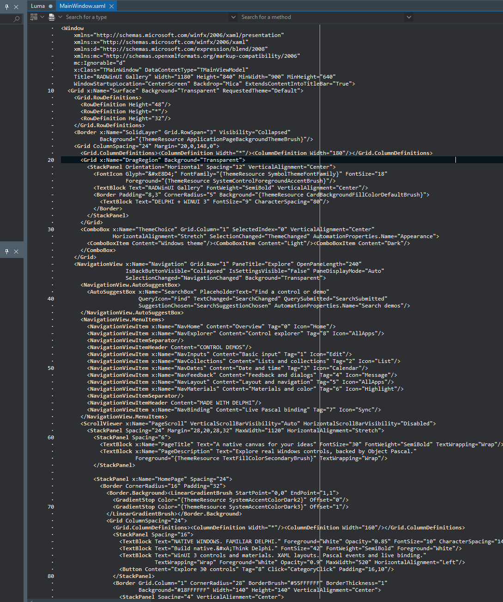
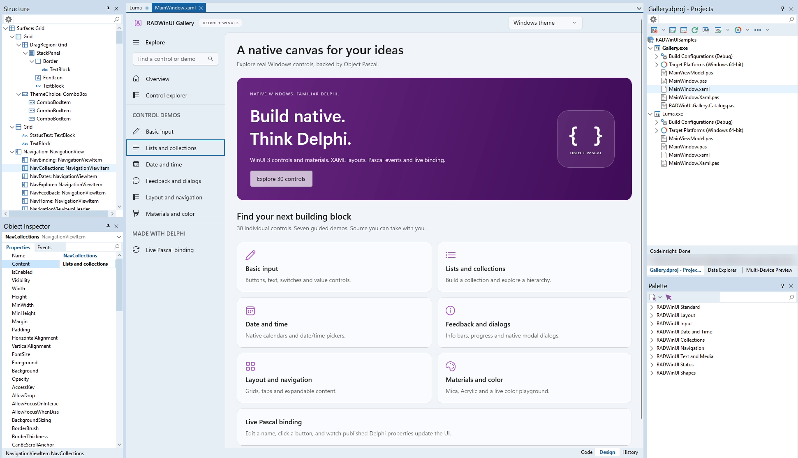
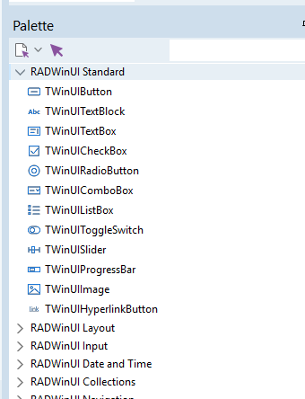
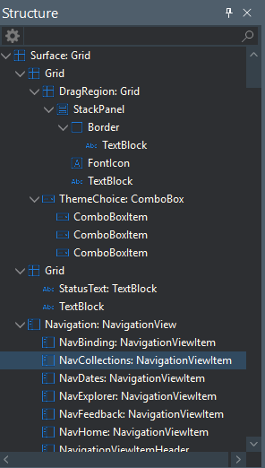

# Getting started

From an empty machine to a WinUI 3 app built, previewed, designed and deployed from RAD Studio.

## 1. Install

| You need | Why |
| --- | --- |
| RAD Studio 13 Florence with Delphi, Win64 platform | compiles apps and the IDE package |
| Windows App Runtime 2.5 x64 | runs WinUI 3 apps (end users need it too, see [Deployment](DEPLOYMENT.md)) |
| Windows 10 1809 or later, Windows 11 recommended | |

No Python and nothing prebuilt: a release is source code, and RAD Studio builds the
three parts RADWinUI needs from one project group.

**0. Prerequisite: download the Windows App SDK files before you open anything in RAD Studio.**
**A clone of the repository does not contain them. Run this once in the RADWinUI folder:**

```text
powershell -ExecutionPolicy Bypass -File scripts\Get-WindowsAppSDK.ps1
```

Without these files the first build stops with *RADWinUI : error RW1001 : Windows App SDK files
are missing*. A release ZIP already contains the one file the build needs, so there you can skip
this step. Add `-InstallRuntime` to the command when the Windows App Runtime 2.5 is not installed
on your PC yet.

In RAD Studio, started **without** administrator rights (WinUI 3 does not run elevated):

1. Uninstall an older RADWinUI package (Component > Install Packages), if any.
2. File > Open Project, in the RADWinUI folder, the group for your IDE: `RADWinUI.groupproj`
   in the 64-bit IDE (`bin64\bds.exe`), `RADWinUI32.groupproj` in the classic 32-bit IDE
   (`bin\bds.exe`). Each holds, in build order: `XamlCodeGen` (makes `bin\XamlCodeGen.exe`,
   which turns each `.xaml` into Pascal), `RADWinUIPreview` (the preview and designer host)
   and the IDE package of that IDE, `RADWinUIWizard` or `RADWinUIWizard32`. Each project has
   one platform, nothing to switch.
3. Right-click the project group > **Build All**.
4. Right-click the package > **Install**.

The demos are another group: `samples\RADWinUISamples.groupproj` (Gallery, Luma, Haven and Lucent).

## Scripts do the same from a command line: `scripts\Build-Wizard.ps1`.

The package adds File > New > RADWinUI Application, File > New > RADWinUI Window, Tools > RADWinUI Preview and Tools > RADWinUI Docked Preview. It finds the RADWinUI folder from its own location, set `RADWINUI_ROOT` to use another checkout.

## 2. A new application

File > New > Other > Delphi Projects > **RADWinUI Application**. Give it a name and a parent folder. You get:

| File | What it is |
| --- | --- |
| `MainWindow.xaml` | the window: XAML you edit |
| `MainWindow.pas` | `TMainWindow`, your code: event handlers and logic |
| `MainWindow.Xaml.pas` | `TMainWindowBase`, generated from the XAML before each build. Do not edit |
| `MainViewModel.pas` | `TMainViewModel`, the data the XAML binds to |
| `<Name>.dpr`, `<Name>.dproj` | Win64 project, the pre-build step runs XamlCodeGen, the post-build step copies the bootstrap DLL next to the exe |

Press F9. A WinUI window opens with a counter, Increment shows "Count: 1".

Another window: File > New > Other > Delphi Files > **RADWinUI Window**.

New application and window templates use `RequestedTheme="Default"` and
`Background="{ThemeResource ApplicationPageBackgroundThemeBrush}" on the root
Grid. Their constructors set the native title bar to `UseDefaultAppMode`.
The application does not force a light/dark override, so it follows Windows.
This follows Microsoft's [theming guidance](https://learn.microsoft.com/en-us/windows/apps/develop/ui/theming).
For an older project with a black transparent surface, add those two Grid
attributes to its XAML. Existing projects are not rewritten by a package update.

For a larger demo, open [RADWinUI Gallery](samples-Gallery.md): seven
categories with native controls, search, materials, theme selection and live
Pascal binding.

## 3. XAML and code



```xml
<Window xmlns="http://schemas.microsoft.com/winfx/2006/xaml/presentation"
        xmlns:x="http://schemas.microsoft.com/winfx/2006/xaml"
        x:Class="TMainWindow" Title="Hello" Width="480" Height="320">
    <StackPanel Spacing="12" Padding="24" RequestedTheme="Default"
                Background="{ThemeResource ApplicationPageBackgroundThemeBrush}">
        <TextBox x:Name="NameBox" Header="Name"/>
        <Button x:Name="GreetButton" Content="Greet"/>
        <TextBlock x:Name="Greeting"/>
    </StackPanel>
</Window>
```

```delphi
type
  TMainWindow = class(TMainWindowBase)
  published
    procedure GreetButtonClick(Sender: TObject; E: TWinUIRoutedEventArgs);
  end;

procedure TMainWindow.GreetButtonClick(Sender: TObject; E: TWinUIRoutedEventArgs);
begin
  Greeting.Text := 'Hello, ' + NameBox.Text + '!';
end;
```

- Every `x:Name` becomes a typed field (`NameBox: TWinUITextBox`).
- A published method `<x:Name><Event>` is wired automatically, `Click="AnyName"` works too.
- The build stops with file, line and reason when a handler, a binding path or a converter is wrong.

The rules XamlCodeGen enforces: [XAML reference](XAML.md). The Pascal API: [Framework API](FRAMEWORK-API.md).

## 4. Binding

```xml
<Window ... DataContextType="TMainViewModel">
    <TextBlock Text="{Binding Count, Converter={StaticResource Format}, ConverterParameter='Count: %s'}"/>
```

```delphi
type
  TMainViewModel = class(TWinUIBindableObject)   // in its own unit
  private
    FCount: Integer;
    procedure SetCount(AValue: Integer);
  published
    property Count: Integer read FCount write SetCount;
  end;

procedure TMainViewModel.SetCount(AValue: Integer);
begin
  FCount := AValue;
  Changed('Count');   // updates every binding of Count
end;
```

The window gets a typed `ViewModel` property: `ViewModel := TMainViewModel.Create;`. Lists bind with `TWinUIBindableList<T>` as `ItemsSource`, `Mode=TwoWay` writes back into the published property. Built-in converters: `BoolToVisibility`, `InverseBoolToVisibility`, `Format`, your own with `TWinUIApp.RegisterConverter`.

## 5. Live preview and designer



<p align="center">
  
  &nbsp;&nbsp;
  
</p>

Open a window's `.xaml` or `.pas` and choose **Tools > RADWinUI Preview**. The XAML renders in its own window, out of the IDE process, and follows every edit within about 150 ms, unsaved text included. Choose **Tools > RADWinUI Docked Preview** to show the same separate-process host in a dockable IDE panel. A broken edit keeps the last good view and shows WinUI's error with the line number. The docked mode's parent, size and shutdown checks pass, its panel behavior still needs confirmation in RAD Studio.

Give bound controls sample values for the preview (the app never sees them):

```xml
<Window ... xmlns:d="http://schemas.microsoft.com/expression/blend/2008"
            xmlns:mc="http://schemas.openxmlformats.org/markup-compatibility/2006" mc:Ignorable="d">
    <TextBox Text="{Binding Name}" d:Text="Ada Lovelace"/>
```

Designer, in the XAML editor's **Design** tab:

| Do | Get |
| --- | --- |
| Click an element | selection box, Delphi's Object Inspector lists its properties and events |
| Change a property | one attribute changes in the editor (Ctrl+Z undoes it) |
| Object Inspector Events tab, ... or double-click | jumps to the handler in the `.pas`, or adds it |
| Object Inspector control selector | selects the Window or another visual control, selection follows in Design and Structure |
| F9 / Ctrl+F9 in Design | invokes Delphi's normal Run / Compile action for the active project |
| Drag from RADWinUI Components in the Tool Palette, or double-click an entry | inserts the control on the Design surface |
| Drag the selected element | in a Grid or Canvas: moves it freely, its outline follows the pointer (Margin, or Canvas.Left/Top), in a StackPanel: reorders it at the blue line |
| Delete / Ctrl+Z / Ctrl+Shift+Z | deletes the selected element / undoes / redoes a XAML edit |

Tools > RADWinUI Preview remains available as a separate rendering window. The integrated Design tab uses the native Tool Palette, Object Inspector and Structure view.

The XAML text is always the source of truth: the designer only edits it, so the editor's undo, diff and version control see every change.

## 6. Deploy

```text
.\scripts\Deploy-App.ps1 -Project <path>\MyApp.dpr
```

builds Release and writes `build\deploy\MyApp` with the exe, the bootstrap DLL and notices, then checks it runs from a folder outside the repository. End users install the Windows App Runtime once. Details: [Deployment](DEPLOYMENT.md).

## Troubleshooting

| Symptom | Fix |
| --- | --- |
| `RADWinUI : error RW1001 : Windows App SDK files are missing`, or a post-build `copy` error in RADWinUIPreview | Run `powershell -ExecutionPolicy Bypass -File scripts\Get-WindowsAppSDK.ps1` once in the RADWinUI folder (step 0), then Build All again. |
| `Microsoft.WindowsAppRuntime.Bootstrap.dll was not found in: ...` | build once (the post-build copies it), or set `RADWINUI_ROOT` |
| The app exits at start with a runtime error | install the Windows App Runtime 2.5 x64 |
| Nothing happens when started from an elevated IDE | start RAD Studio without administrator rights |
| `XamlCodeGen did not run`, or a build stops at its pre-build event | open the group of your IDE (`RADWinUI.groupproj` in the 64-bit IDE, `RADWinUI32.groupproj` in the classic 32-bit IDE) and Build All (it makes `bin\XamlCodeGen.exe`). A project made by 0.9.3-rc.3 or older runs `py -3 ...xamlcodegen.py` before each build: in Project > Options > Building > Build Events, change it to `"<RADWinUI>\bin\XamlCodeGen.exe" "$(MSBuildProjectDirectory)"` |
| No Tools > RADWinUI Preview | Build All of the group of your IDE, install its package, then restart the IDE |
