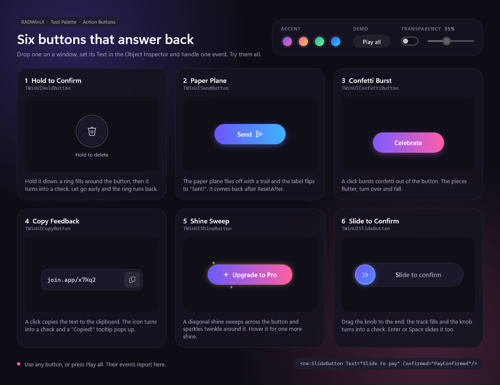
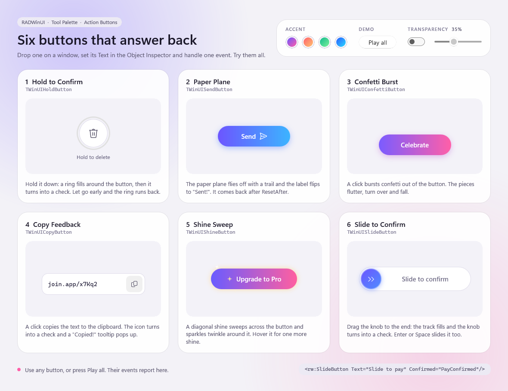

# Action Buttons

One window that shows all six animated buttons of the Tool Palette's Action Buttons category, each on a card of its own: hold to confirm, a paper plane, a confetti burst, copy feedback, a shine sweep and slide to confirm. Use any of them, and the line at the bottom shows the event it raised. The page follows the Windows theme, and the desktop can show through it.





Open `samples\ActionButtons\ActionButtons.dproj` in RAD Studio 13 and run Win64. Or, from the repository root:

```powershell
.\scripts\Build.ps1 -Project samples\ActionButtons\ActionButtons.dpr -Config Release
.\samples\ActionButtons\Win64\Release\ActionButtons.exe
```

## What it shows

| Card | Control | Try it | Event |
| --- | --- | --- | --- |
| Hold to Confirm | `TWinUIHoldButton` | Hold it down until the ring is full, or let go early | `Confirmed` |
| Paper Plane | `TWinUISendButton` | Click it | `Click` |
| Confetti Burst | `TWinUIConfettiButton` | Click it, again and again | `Click` |
| Copy Feedback | `TWinUICopyButton` | Click it, then paste somewhere | `Copied` |
| Shine Sweep | `TWinUIShineButton` | Hover it, click it | `Click` |
| Slide to Confirm | `TWinUISlideButton` | Drag the knob to the end, or focus it and press Enter | `Confirmed` |

The panel at the top changes every button at once:

- **Accent** sets `AccentFrom` and `AccentTo`: each button's own colours, sunset, mint or ocean.
- **Play all** runs every button's effect with `Play`, one after the other, so a wave runs across the page.
- **Transparency** makes the window see-through: the window gets a `Transparent` backdrop and the slider sets how much of the desktop shows through the page, up to 90%. Off, the window has Mica and its usual frame under an opaque page.

## How it is built

Each card is plain XAML. A button needs its text and one event:

```xml
<rw:SlideButton x:Name="SlideButton1" Text="Slide to confirm" DoneText="Confirmed" Confirmed="SlideConfirmed"/>
```

Every colour of the page is a theme resource with a Light and a Dark value. The buttons on a surface (Hold, Copy and Slide) take theirs through `Background`, `BorderBrush` and `Foreground`.

`MainWindow.pas` holds only the panel at the top and the status line.
