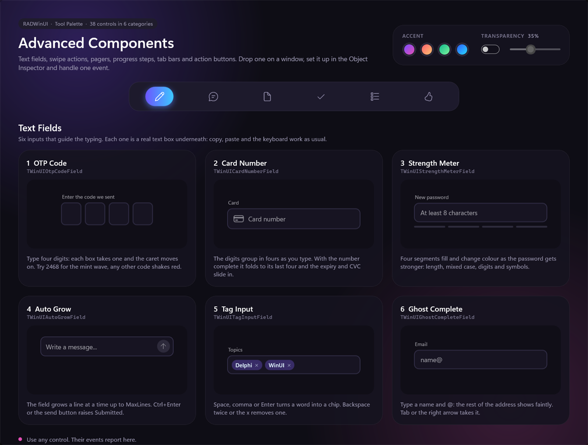

# Advanced Components

One window with RADWinUI's 38 advanced controls, a section per Tool Palette category: Text Fields, Swipe Actions, Pagination, Progress Steps, Tab Bars and Action Buttons. Every control sits on a card of its own with its class name and what to try. Use any of them, and the line at the bottom shows the event it raised. The page follows the Windows theme, and the desktop can show through it.



Open `samples\AdvancedComponents\AdvancedComponents.dproj` in RAD Studio 13 and run Win64. Or, from the repository root:

```powershell
.\scripts\Build.ps1 -Project samples\AdvancedComponents\AdvancedComponents.dpr -Config Release
.\samples\AdvancedComponents\Win64\Release\AdvancedComponents.exe
```

## What it shows

| Section | Controls | Try it |
| --- | --- | --- |
| Fields | `TWinUIOtpCodeField`, `TWinUICardNumberField`, `TWinUIStrengthMeterField`, `TWinUIAutoGrowField`, `TWinUITagInputField`, `TWinUIGhostCompleteField` | Type 2468 in the code boxes, a card number, a password, a long message, a few topics, and a name with `@` |
| Swipe | `TWinUISwipeCardStack`, `TWinUIPinSwipeList`, `TWinUIPeekSwipeList`, `TWinUILiquidDeleteList`, `TWinUISnoozeSwipeList`, `TWinUIUndoSwipeList` | Drag the cards and the rows. **Bring the rows back** refills the lists |
| Pages | The eight pagers, from `TWinUIClassicPager` to `TWinUIStepsPager` | Click pages and arrows, or use the arrow keys |
| Steps | The six progress steps, from `TWinUINumberedSteps` to `TWinUIRingSteps` | **Back** and **Next** move all six, or click a step |
| Tabs | The six tab bars | Tap the tabs |
| Buttons | The six action buttons | Hold, click and slide them |

The bar at the top that switches the sections is a `TWinUISlidingPillTabBar`. Its `Pages` property names the six sections, so the bar shows the one of the selected tab without any code.

The panel at the top changes every control at once:

- **Accent** sets `AccentFrom` and `AccentTo` on all 38 controls: their own colours, sunset, mint or ocean.
- **Transparency** makes the window see-through: the window gets a `Transparent` backdrop and the slider sets how much of the desktop shows through the page, up to 90%. Off, the window has Mica and its usual frame under an opaque page.

## How it is built

Each card is plain XAML. A control needs its data and one event:

```xml
<rw:UndoSwipeList x:Name="UndoList1" Width="290" Deleted="RowDeleted" Restored="RowRestored"/>
<rw:CheckoutSteps x:Name="CheckoutSteps1" Step="2" StepChanged="StepChanged"/>
```

Every colour of the page is a theme resource with a Light and a Dark value. The new controls pick their own surfaces from the theme, the tab bars and the buttons on a surface take theirs through `Background`, `BorderBrush` and `Foreground`.

`MainWindow.pas` holds the event handlers that write the status line, the code check of the OTP field, Back and Next, the accent colours and the transparency.
