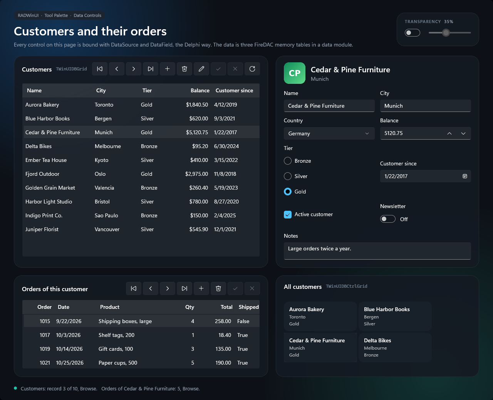
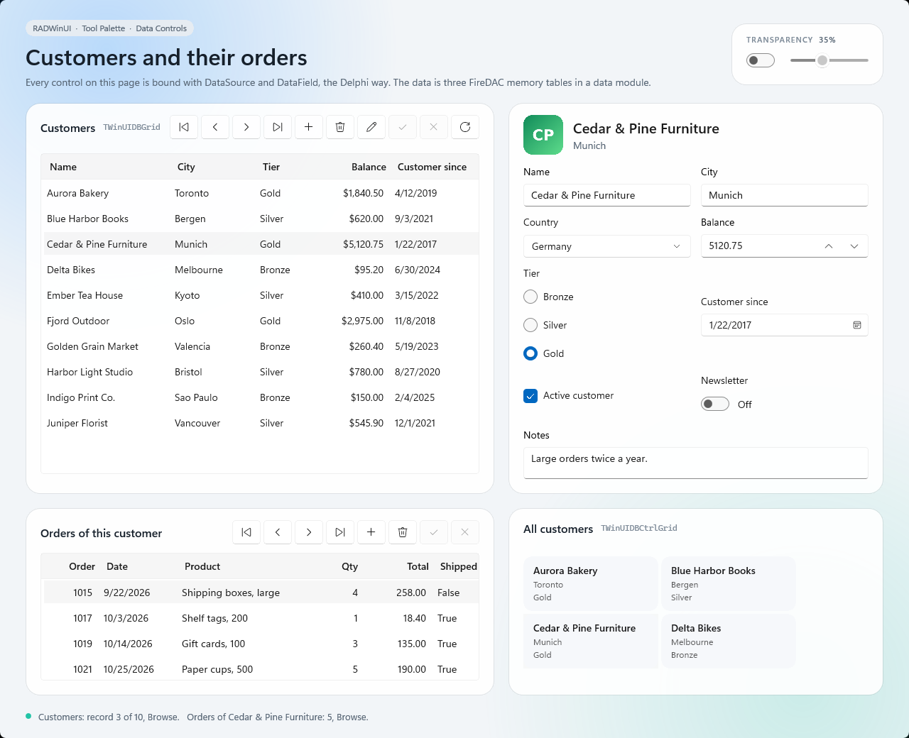

# Data Controls

Customers and their orders, shown and edited with the data-aware controls of the Tool Palette's Data Controls category. Every control on the page is bound with `DataSource` and `DataField`, the Delphi way, and the window needs no code to show or edit the data. The page follows the Windows theme, and the desktop can show through it.





Open `samples\DataControls\DataControls.dproj` in RAD Studio 13 and run Win64. Or, from the repository root:

```powershell
.\scripts\Build.ps1 -Project samples\DataControls\DataControls.dpr -Config Release
.\samples\DataControls\Win64\Release\DataControls.exe
```

## What it shows

| Card | Controls | Try it |
| --- | --- | --- |
| Customers | `TWinUIDBGrid`, `TWinUIDBNavigator` | Click a row or move with the navigator, click a header to sort, insert, edit, post, cancel or delete a customer |
| The current customer | `TWinUIDBImage` (the logo), `TWinUIDBText`, `TWinUIDBEdit`, `TWinUIDBLookupComboBox` (the country), `TWinUIDBNumberBox`, `TWinUIDBRadioGroup` (the tier), `TWinUIDBDatePicker`, `TWinUIDBCheckBox`, `TWinUIDBToggleSwitch`, `TWinUIDBMemo` | Change a value and watch the grid and the tiles follow. Enter writes a field and Esc puts it back |
| Orders of this customer | `TWinUIDBGrid`, `TWinUIDBNavigator` | A master/detail grid: it shows the orders of the current customer. Edit a cell, add or delete an order |
| All customers | `TWinUIDBCtrlGrid` | Every customer as a tile, drawn by its own `ItemTemplate` |

The Newsletter switch writes `Y` or `N` into its field with `ValueChecked` and `ValueUnchecked`. The line at the bottom shows the record and the state of both datasets. It comes from the `OnDataChange` and `OnStateChange` events of the data sources, the same events the controls cause.

**Transparency** makes the window see-through: the window gets a `Transparent` backdrop and the slider sets how much of the desktop shows through the page, up to 90%. Off, the window has Mica and its usual frame under an opaque page.

## How it is built

The data is three FireDAC `TFDMemTable` (countries, customers and orders), each with a `TDataSource`, in the `TCustomerData` data module (`CustomerDataModule.pas` and `.dfm`). The field definitions are in the `.dfm`, so the Object Inspector lists the fields for `DataField`. The records are filled in when the module is created, and each customer gets a logo from the `Logos` folder for the DBImage. The `.dpr` creates the data module before the window, so the window finds the data sources by name.

Each card is plain XAML. A control needs its data source and its field:

```xml
<rw:DBLookupComboBox x:Name="CountryCombo" DataSource="CustomersSource" DataField="CountryID"
                     ListSource="CountriesSource" KeyField="ID" ListField="CountryName" Header="Country"/>
```

Every colour of the page is a theme resource with a Light and a Dark value.

`MainWindow.pas` holds only the status line and the transparency switch.
