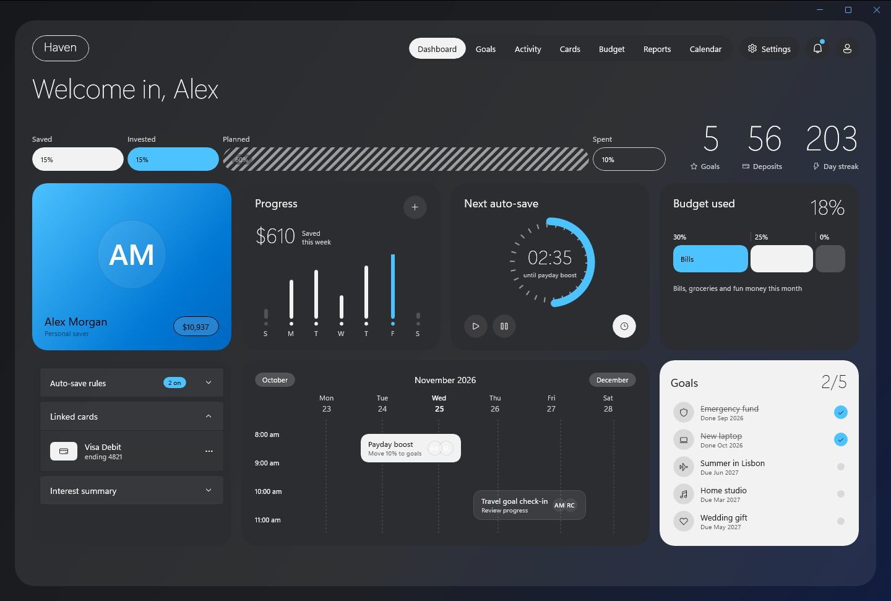

# Haven

A bento-style savings dashboard made with Delphi and WinUI 3: a weekly deposits chart, a countdown dial, a budget bar, auto-save rules, a calendar and a goals checklist. It follows the Windows theme and accent colour live, and every number and toggle is bound to a Delphi view model.




Open `samples\Haven\Haven.dproj` in RAD Studio 13 and run Win64. Or, from the repository root:

```powershell
.\scripts\Build.ps1 -Project samples\Haven\Haven.dpr -Config Release
.\samples\Haven\Win64\Release\Haven.exe
.\scripts\Test-Haven.ps1 -NoBuild
```

Pass `-light` or `-dark` to `Haven.exe` to pick a theme without changing the Windows setting.

## How it is made

- **Theme and accent.** Every colour is a `ThemeResource`. The page's own brushes (background, cards, the "ink" pills) live in `ThemeDictionaries` with a Light and a Dark entry, so the dark theme inverts them: charcoal cards, a light Goals card. Highlights use the system accent (`AccentFillColorDefaultBrush`, `SystemAccentColor` and its lighter and darker shades), so changing the accent in Windows recolours the dashboard at once.
- **Binding.** `MainWindow.xaml` binds to `TMainViewModel` (`DataContextType`). The total, this week's bars, the countdown, the "N on" pill and the goal caption are read-only properties that the view model updates with `Changed`. The three toggles bind two-way (`IsOn="{Binding RoundUps, Mode=TwoWay}"`), so switching one updates the pill.
- **Goals.** `GoalList` is a `ListView` whose `ItemsSource` is a `TWinUIBindableList<TGoal>`. Clicking a goal marks it done or open through `ItemClick`: the strikethrough, the accent check and the "2/5" caption follow, using the `BoolToVisibility` converters.
- **Interaction.** The + button adds $50 to today, and play and pause run the countdown dial (a `ProgressRing` over a dashed `Ellipse`).

The page scrolls when the window is smaller than the dashboard.

## Automated check

`scripts\Test-Haven.ps1` builds Haven and runs a smoke test: the initial values, toggling a goal, a two-way toggle, adding money and the countdown. Pass `-Monitor offscreen` on a PC with one screen: the window then opens outside every monitor and never takes the focus.
