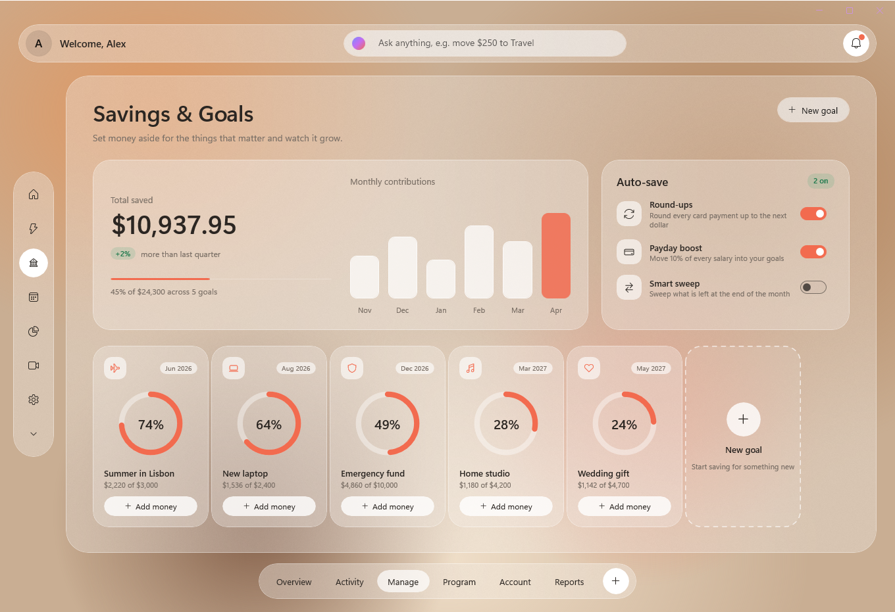

# Haven

A glassy savings dashboard made with Delphi and WinUI 3: frosted acrylic cards over a warm background, a monthly contributions chart, auto-save rules and savings goals with progress rings. Every number and toggle is bound to a Delphi view model.



Open `samples\Haven\Haven.dproj` in RAD Studio 13 and run Win64. Or, from the repository root:

```powershell
.\scripts\Build.ps1 -Project samples\Haven\Haven.dpr -Config Release
.\samples\Haven\Win64\Release\Haven.exe
.\scripts\Test-Haven.ps1 -NoBuild
```

## How it is made

- **Glass.** The cards use an in-app `AcrylicBrush` (white tint, low opacity) with a 1 px light border and large corner radii. Behind them the window draws its own warm background in XAML: a few large `RadialGradientBrush` blobs. The acrylic blurs those blobs, so the glass looks the same on every desktop. No image file is used.
- **Binding.** `MainWindow.xaml` binds to `TMainViewModel` (`DataContextType`). The total, the progress caption, the monthly bars and the "N on" pill are read-only properties that the view model updates with `Changed`. The three toggles bind two-way (`IsOn="{Binding RoundUps, Mode=TwoWay}"`), so switching one updates the pill.
- **Goals.** `GoalGrid` is a `GridView` whose `ItemsSource` is a `TWinUIBindableList<TGoal>`. The item template binds each card's ring, percentage and amount. Clicking a card (or its Add money pill) adds $100 through `ItemClick`: the ring, the total and this month's bar all follow. The last item is the "New goal" card, shown by the same template with the `BoolToVisibility` converters.
- **Lightweight styling.** The coral toggle colour comes from `ToggleSwitchFillOn` resources on the root grid, the card look from one `Style`.

The cards wrap when the window gets narrower, and the page scrolls.

## Automated check

`scripts\Test-Haven.ps1` builds Haven and runs a smoke test: the initial totals, adding money to a goal, a two-way toggle and a new goal. Pass `-Monitor offscreen` on a PC with one screen: the window then opens outside every monitor and never takes the focus.
