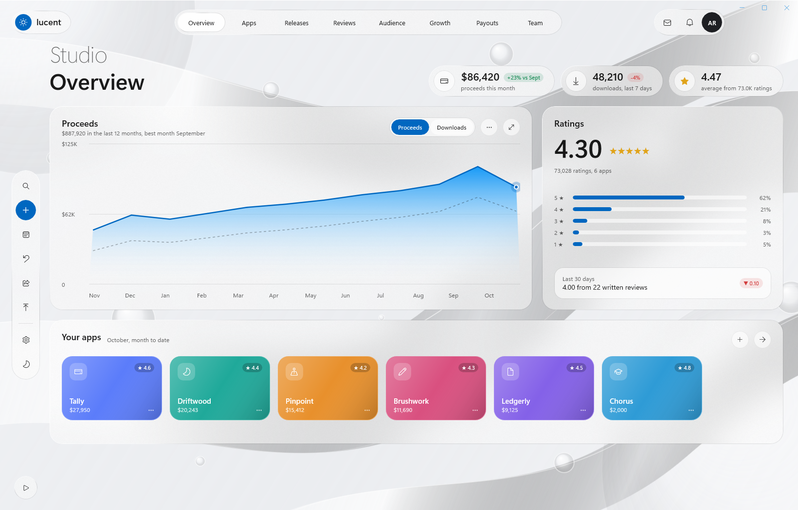
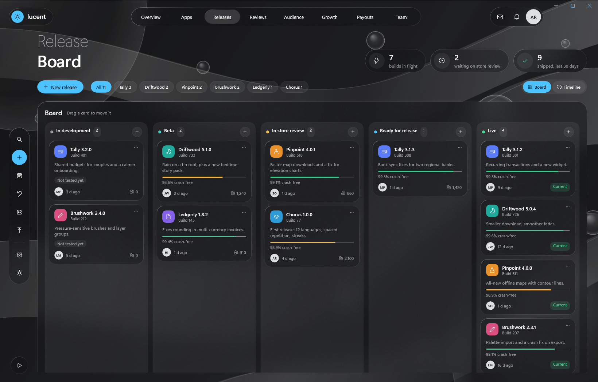
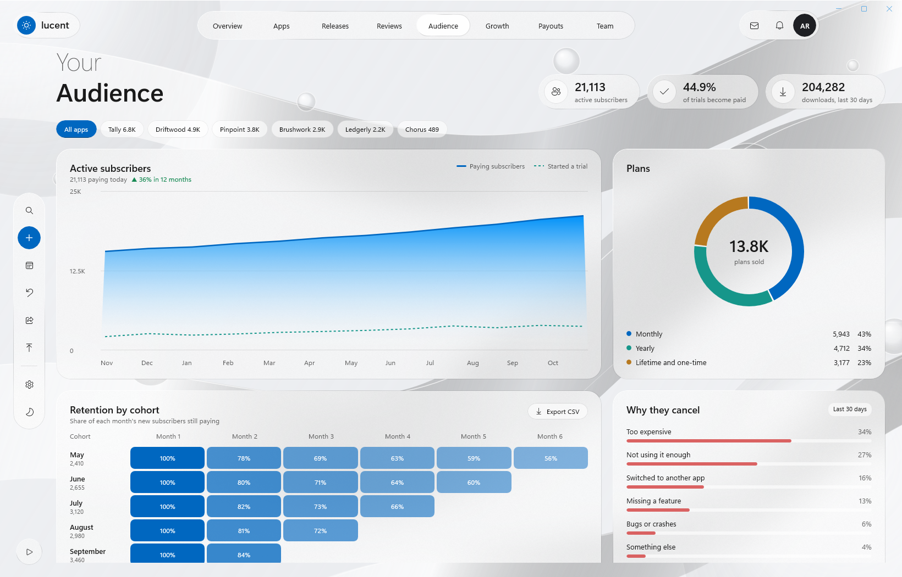

# Lucent

An app publishing studio made with Delphi and WinUI 3: frosted glass panels over slowly drifting ribbons and floating bubbles, eight pages with animated transitions, and live simulated data. It follows the Windows theme and accent colour, and the rail's sun and moon button switches the theme by hand. All the apps, people and numbers are made up.








Open `samples\Lucent\Lucent.dproj` in RAD Studio 13 and run Win64. Or, from the repository root:

```powershell
.\scripts\Build.ps1 -Project samples\Lucent\Lucent.dpr -Config Release
.\samples\Lucent\Win64\Release\Lucent.exe
.\scripts\Test-Lucent.ps1 -NoBuild
```

Command-line switches: `-light` and `-dark` pick a theme, `-page:N` opens page N (0 is Overview, 8 the app detail page), `-nosim` starts with the live data paused.

## The pages

| Page | What it shows and does |
| --- | --- |
| Overview | Proceeds this month, downloads and the average rating; a 12-month chart (Proceeds or Downloads, with last year dashed) that draws in from the left and can be expanded or exported; star bars; the app cards, each opening its app page |
| Apps | A search box, sort pills that move the cards to their new places, and an app card grid. A card flies into the hero of the app's page (Overview, Versions, In-app purchases, Reviews), the back button returns |
| Releases | Filter chips per app, a five-column board with drag and drop (the counts and KPIs follow), "+" in each column, undo on the rail, and a timeline view |
| Reviews | Star and app filters, and a review list: click a review to reply |
| Audience | A subscriber chart with a tooltip that follows the pointer, a plans donut, a retention heatmap that exports as CSV, and cancel reasons |
| Growth | Acquisition sources, a conversion funnel, top regions and running campaigns |
| Payouts | The next payout with the payment cycle, October by app, the payout history (saved as a statement CSV), the payout account and tax status |
| Team | Member cards with online status, Invite, and a live activity feed |

The live data ticks every 1.5 s: proceeds, downloads, subscribers and the charts move, and now and then a review arrives (a toast and the red dot on the bell), a build moves along the board, or a team member comes online. The Live button at the bottom left pauses it. Exports go to `Documents\Lucent`.

## How it is made

- **Glass.** Two layers of frost. The window has the desktop Acrylic backdrop (`Backdrop="Acrylic"`, as in Luma), and the page fill above it is translucent, so the desktop behind the window shows through, blurred. On top drift the ribbons, thick stroked `Path`s with gradient brushes in a `Viewbox`, and the bubbles, ellipses with a `RadialGradientBrush` highlight. The panels use an in-app `AcrylicBrush` with a gradient rim (light at the top left, darker at the bottom), which blurs the ribbons and bubbles once more. No image file is used. Real lens refraction, as in some web designs, is not available to XAML, so the glass is acrylic plus highlights.
- **Transparency.** Lucent follows the Windows "Transparency effects" setting, and Settings > Transparency switches it by hand. Off, the window is opaque. Windows shows the backdrop's plain fallback colour while the window is inactive.
- **Theme and accent.** Every colour is a `ThemeResource`. The page's own brushes live in `ThemeDictionaries` with a Light and a Dark entry, and highlights use the system accent.
- **Motion.** `RADWinUI.Motion` runs the animations on the compositor thread: the backdrop drifts (`Drift`), pages leave and enter with a stagger (`Leave`, `Enter`), charts draw in (`Reveal`), the donut turns in (`Sweep`), the nav pill slides (`SlideTo`), cards lift on hover (`Lift`), the app card flies into the detail hero (`Hero`), and the live dot pulses. Lists animate with `EntranceThemeTransition`, `RepositionThemeTransition` and `AddDeleteThemeTransition`. The Animations switch in Settings turns motion off, and Lucent starts without it when Windows animation effects are off.
- **Numbers.** Counters in `TMainViewModel` glide to new values and count up from zero when a page appears. They are published indexed properties, so the XAML binds them like any other text.
- **Binding.** The window binds to `TMainViewModel`, lists are `TWinUIBindableList<T>` of bindable items (`StudioData.pas`), and the app page binds to the selected app with `DataContext="{Binding Detail}"`.
- **Charts.** Lines and areas are a `Polyline` and a `Polygon` whose points are computed in Pascal when the data or the size changes. The donut is three ellipses with a dash pattern.
- **Drag and drop.** Each board column is a `ListView` with `CanDragItems` and `AllowDrop`. `DragItemsStarting` remembers the card and `Drop` moves it in the view model, which moves it between the column lists.

## Automated check

`scripts\Test-Lucent.ps1` builds Lucent and runs a smoke test with the live data paused: every page, search and sort, an app page and back, a board move and undo, the release filter, the star filter, the chart tooltip, Invite and the theme switch. Pass `-Monitor offscreen` on a PC with one screen: the window then opens outside every monitor and never takes the focus.
