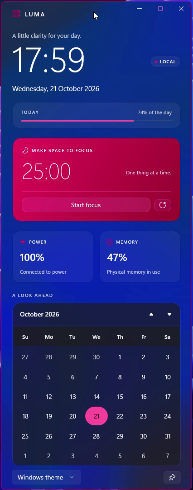

# Luma

A small desktop companion made entirely with Delphi and WinUI 3: real desktop Acrylic, Windows accent colors, theme-aware cards, a live clock and date, battery and memory readings, a 25-minute focus timer, and the native calendar.

<p align="center">
  
</p>

Open `samples\Luma\Luma.dproj` in RAD Studio 13 and run Win64. The window sits near the right edge of the screen, fits the available height, and remains resizable. Use the pin button to keep it above other windows. The appearance selector defaults to Windows theme, Light and Dark let you explore both appearances without changing Windows settings.

From the repository root:

```powershell
.\scripts\Build.ps1 -Project samples\Luma\Luma.dpr -Config Release
.\samples\Luma\Win64\Release\Luma.exe
.\scripts\Test-Luma.ps1 -NoBuild
```

`MainWindow.xaml` owns the design. Its generated base wires published Pascal handlers and gives the window a typed `TMainViewModel`. The view model reads real system information and uses a monotonic clock for the focus countdown. The application makes no network requests and installs no desktop extensions.

The transparent root exposes `Backdrop="Acrylic"`, `{ThemeResource}` provides the card, text and accent colors. Windows can show a solid fallback when the window is inactive, transparency is disabled, or its power/accessibility policy requires it. This is the native material behavior described in Microsoft's [system backdrop documentation](https://learn.microsoft.com/en-us/windows/apps/develop/ui/system-backdrops).

The smoke test opens on a secondary monitor without taking focus and checks native XAML loading, Unicode glyphs, data binding, focus start/reset, system readings, and light/dark themes. It does not change the Windows theme.
