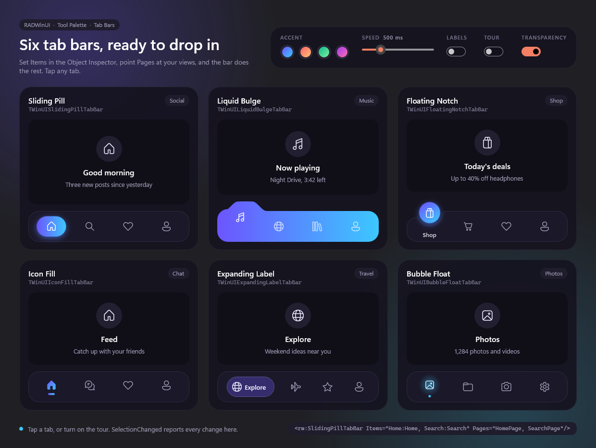
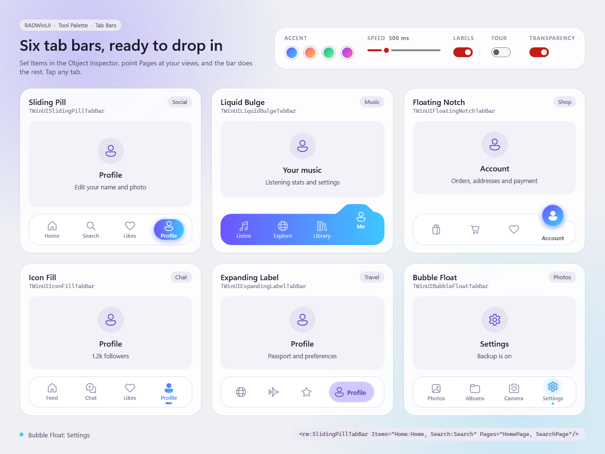

# Tab Bars

One window that shows all six animated tab bars of the Tool Palette's Tab Bars category. Each sits on a card of its own with a theme: a social feed, a music player, a shop, a chat, a travel planner and a photo library. Tap any tab and its card shows that tab's page. The page follows the Windows theme, and the desktop can show through it.





Open `samples\TabBars\TabBars.dproj` in RAD Studio 13 and run Win64. Or, from the repository root:

```powershell
.\scripts\Build.ps1 -Project samples\TabBars\TabBars.dpr -Config Release
.\samples\TabBars\Win64\Release\TabBars.exe
```

## What it shows

| Card | Control | Tabs |
| --- | --- | --- |
| Social | `TWinUISlidingPillTabBar` | Home, Search, Likes, Profile |
| Music | `TWinUILiquidBulgeTabBar` | Listen, Explore, Library, Me |
| Shop | `TWinUIFloatingNotchTabBar` | Shop, Cart, Saved, Account |
| Chat | `TWinUIIconFillTabBar` | Feed, Chat, Likes, Profile |
| Travel | `TWinUIExpandingLabelTabBar` | Explore, Trips, Saved, Profile |
| Photos | `TWinUIBubbleFloatTabBar` | Photos, Albums, Camera, Settings |

The panel at the top changes every bar at once:

- **Accent** sets `AccentFrom` and `AccentTo`: violet to cyan, sunset, mint or aurora.
- **Speed** sets `AnimationDuration`, from 200 to 1500 ms.
- **Labels** sets `ShowLabels`. Floating Notch and Expanding Label always show theirs.
- **Tour** taps the next tab of one bar after the other, so a wave runs across the page.
- **Transparency** makes the window see-through: the window gets a `Transparent` backdrop and the slider sets how much of the desktop shows through the page, up to 90%. Off, the window has Mica and its usual frame under an opaque page.

The line at the bottom is written by `SelectionChanged`, which all six bars share.

## How it is built

Each card is plain XAML. The bar names its tabs in `Items` and the page of each tab in `Pages`, and switches the pages itself:

```xml
<rw:SlidingPillTabBar x:Name="PillBar" Items="Home:Home, Search:Search, Likes:Heart, Profile:Contact"
    Pages="PillHome, PillSearch, PillLikes, PillProfile" SelectionChanged="TabChanged"/>
```

Every colour of the page is a theme resource with a Light and a Dark value. The bars take theirs through `Background`, `BorderBrush` and `Foreground`, and on a light bar they pick darker colours for the selected tab by themselves.

`MainWindow.pas` holds only the panel at the top and the status line, about 150 lines.
