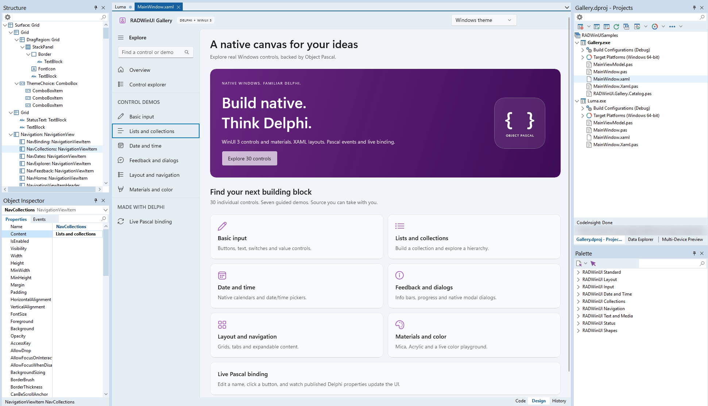

# Visual designer

`.xaml` files open in a Design view next to Code (F12 switches between them). Design shows the real WinUI rendering, hosted in the preview process so a WinUI problem never affects RAD Studio. Every change is a small, undoable edit of the XAML text, which stays the single source of truth.

- **Selection.** Click an element in Design to select it. The selection follows into the Object Inspector and the Structure view, and back.
- **Tool Palette.** Pick a control and click where it goes (a StackPanel position, or a Grid row and column), or drag it in. Drag the selected element to move it, Delete removes it, Ctrl+C, Ctrl+V, Ctrl+Z and Ctrl+Y work as in a VCL form.
- **Context menu.** Right-click an element (or press the Menu key or Shift+F10) for Undo, Redo, Cut, Copy, Paste, Delete, Select Parent (Esc), Bring to Front, Send to Back, View Source (the code at the element) and Split View. Below them come the commands of the element itself: create or open its default event handler, Add Row and Add Column on a Grid, Orientation on a StackPanel, add an item to a TabView, NavigationView, ListView, GridView, ListBox, ComboBox, MenuBar, RadioButtons or Pivot, Edit Items... on a tab bar, and Edit Text... (Text, Content, Header or Title). A right click beside every element selects the Window.
- **Split View.** Shows the XAML code in the editor and the live designer in the docked preview panel next to it. Selecting in the preview moves the cursor to the element's code, editing the code updates the preview. Choose Split View again, or switch the editor back to Design, to end it. The Structure view shows the design tree while the designer has the focus.
- **Moving with the keyboard.** Ctrl+Arrow moves the selected element by 1 pixel, Ctrl+Shift+Arrow by 8, in a Grid (Margin with Left/Top alignment) or a Canvas (Canvas.Left/Top). A row of key presses is one undo step. Elements that their panel lays out (a StackPanel's children, the Window's content, a Grid laid out by Align) stay where they are.
- **Alignment guides.** While an element is dragged or moved with the keys, thin blue lines show where its edges or centre line up with a sibling or its panel. A drag snaps to them within 4 pixels, hold Alt to place it freely.
- **Object Inspector.** Properties and events of the selected element, see [docs/OBJECT-INSPECTOR.md](OBJECT-INSPECTOR.md).
- **Structure view.** The element tree with the same icons as the Tool Palette.

| Unit | Role |
| --- | --- |
| `RADWinUI.Designer.XamlEdit` | Minimal text edits: change, insert, move and delete elements and attributes |
| `RADWinUI.Designer.Model` | Type index, property and event lists, handler creation in the window unit |
| `RADWinUI.Designer.Palette`, `.PaletteIcons` | Tool Palette entries, categories and self-painted icons |
| `RADWinUI.Designer.Settings` | RADWinUI's IDE settings in the registry: AI suggestions, their pause, code completion |
| `RADWinUI.Designer.AICompletion` | AI in the XAML editor: the prompts for the IDE's AI engine, the state of the suggestions while typing, the insertion of answers |
| `RADWinUI.Designer.ObjectInspector`, `.Structure` | ToolsAPI adapters for the native Object Inspector and Structure view |
| `RADWinUI.Designer.TabItemsEditor` | The '...' editor of a tab bar's Items: tabs, labels and icons |
| `RADWinUI.Designer.Dialogs` | Message and text dialogs in the IDE theme, and the theme for the designer's own forms |
| `RADWinUI.Designer.Snap` | Alignment guide math of the preview host, no WinUI |
| `RADWinUI.Designer.Inspector` | An older IDE-free property panel, kept for its tests |

The IDE-free units are tested outside the IDE by `tests\Designer\XamlEditTest` and `tests\Designer\DesignerModelTest`, `scripts\Test-Preview.ps1` checks selection, insert, move and delete end to end against the real preview host.
